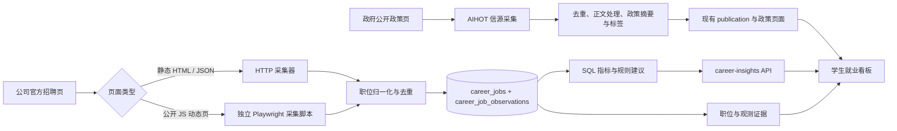

# AI+ 就业趋势观察平台：一周 MVP 路线图

> 状态：A 角色 D1/E1/C 集成已通过二次独立 review；MVP 真实采集与完整业务闭环尚未完成  
> 启动日期：2026-11-16  
> 最近更新：2026-11-17  
> 并行基线：`42bf4cf feat: establish career-insights collaboration baseline`  
> 私有仓库：`https://github.com/seevence/AIHOT`  
> 交付目标：下周评审  
> 开发节奏：**5 天完成真实闭环 + 2 天联调、补证据和排练**  
> 首发范围：IT 行业中的 **人工智能+** 方向  
> 核心受众：希望了解行业方向、岗位要求和技能准备路径的大学生

## 0. 当前执行状态

五人并行开发所需的准备工作已经完成并推送到五条远程分支。本文后续勾选状态分为“准备基线”和“最终 MVP 验收”，不能把模块骨架完成当作真实数据闭环完成。

| 准备项 | 当前状态 | 后续业务任务 |
|---|---|---|
| 五条远程分支 | `feat/integration`、`feat/career-collector`、`feat/career-data-metrics`、`feat/career-api`、`feat/career-dashboard` 均包含 `42bf4cf` | B/C/D/E 各自提交业务 PR 到 `feat/integration` |
| 共享契约 | `contracts/job.ts`、`api.ts`、`index.ts`、`openapi.json` 已建立；`contract_version=0.1` | 真实样本验收后升级 `1.0`，破坏性变更需评审 |
| 模块接入 | `site/modules/` 三份清单、`site/package.json`、根锁文件和 Dockerfile 已接入 | A 维护集成与构建 |
| 数据底座 | `RawCollectedJobV1`、`NormalizedJobV1`、校验器、五项指标规范、初版词典已建立 | B 真实采集；C 归一化、去重和真实指标计算 |
| 数据表与后端 | 两张表及两个索引迁移、Repository 接口、三个 GET stub 已建立 | D 实现 SQL repository、队列和真实 API；unavailable stub 当前返回 `503 data_unavailable` |
| 前端 | 看板/详情骨架、状态组件和独立 fixture server 已建立 | E 接真实 API，完善筛选、证据和响应式页面 |
| 编译检查 | `npm run typecheck`、`npm run build -w @aihot/web` 已通过 | 后续 PR 和最终验收仍需重新执行相关检查 |
| Docker 运行验收 | 镜像已重建；`0152`–`0155` 四个 career 迁移已应用；`/career-insights` 显示“数据尚未就绪”错误态，三个 GET 返回 `503 data_unavailable` 或参数 `400` | B/C/D/E 接入真实数据后用 `--require-data` 复验 |

团队唯一启动入口为 `docs/team-startup.md`，契约说明为 `docs/development-contract.md`。正式 route 不引用 fixture；fixture 页面必须显示“联调样例（非真实数据）”。

**A 角色 D1 运行集成记录（2026-11-16，`feat/a-d1-runtime`）：**

- 新增 `scripts/check-career-integration.ts`，默认接受预数据阶段的渲染后 `503` 错误页和 API `503 data_unavailable`；`--require-data` 从 D2 起强制真实数据。
- 基线迁移 `0153_career_job_observations.sql` 的在线安全检查阻塞已在 `feat/integration` 提交 `9affed2` 修复：`id` 列类型仍为 `bigint`、默认值由序列生成，不再强制 identity 约束；repository 写入不得显式提供 `id`。字段与唯一性不变。
- 验收命令：`node scripts/check-career-integration.ts --base http://localhost:3000` 五项通过；`node scripts/check-migrations.ts --base feat/integration` 通过；`npm run typecheck` 与脚本单文件 `tsc --noEmit` 通过。
- 本阶段改动保持独立分支，独立 review 通过后才并入 `feat/integration`；不进入下一阶段。

**A 角色 D2 集成门禁记录（2026-11-17，`feat/a-d2-gates`）：**

- `.github/workflows/check.yml` 的 Docker job 在通用 smoke 后用同一镜像执行 `scripts/check-career-integration.ts --base http://web:3000`，覆盖模块注册、页面、health、summary/jobs 和非法 ID 路由；不再依赖手工“额外验证”。
- 容器内 CI 同款命令已实测五项通过；`docs/team-startup.md` 补充 CI 行为说明，工程质量清单改为可直接执行的脚本命令。
- 本阶段仅改 CI、启动文档和路线图，保持独立分支，独立 review 通过后才并入 `feat/integration`。

**A 角色 D1/E1/C 集成记录（2026-11-17，`feat/a-d3-integration`）：**

- 已合入 D1 `6aed150`（SQL repository、幂等 ingest、队列）与 E1 `e7d4c21`（筛选、分页、证据面板），E1 合并提交 `53e234d`；已合入 C 的远程分支 `b8d6de8`（归一化、去重、指标、质量与样例），C 合并提交 `e7f6c9f`。
- C 与 D 在 `data/metrics.ts` 的导入处冲突已按 C 的完整指标实现解决，保留 `.ts` 扩展名；`data/validate.ts` 的 `.ts` 基线修复随合并同步。
- `docs/development-contract.md` §8.5 已明确逐项错误 `{ index, code, message }` 与 `path: message` 格式，和 D 的 ingest 实现对齐。
- 验证：`npm run typecheck`、`npx tsc -p modules/tsconfig.json`、Web 构建通过；standalone `311/311` 通过；D SQL+ingest `12/12` 通过（临时 PostgreSQL 5433）。
- Docker 重建后 `node scripts/check-career-integration.ts --base http://localhost:3000` 五项通过，通用 `node scripts/smoke.ts --base http://localhost:3000` 通过，`db/api/worker/web` 全部运行。
- 首轮独立 review **FAIL**：D SQL summary 的空样本职族/无技能占位与观测新增分母不符合 C 指标口径，E 多维指标卡片存在重复 React key。D 修复 `7851ff3`、E 修复 `b88662c` 已合回阶段分支（E 修复合并提交 `5cd1415`）；复验 D SQL+ingest `13/13`、模块与前端类型检查、Web 构建均通过。
- 政策 `shared_themes`、来源覆盖校验、未识别技能比例仍为 D3 遗留，不在本阶段扩展实现。
- 二次独立 review **PASS**（T8，复核提交 `c5bf669`）：空样本职族、无技能占位、观测新增分母、多维指标 key 四项均闭环，无剩余阻断项。现仅追加本阶段结论并合回本地 `feat/integration`；不推送，真实采集闭环未完成。

**A 角色 E1–E4 与外壳集成记录（2026-11-17，`feat/a-shell-fixes`）：**

- 合入 E 已评审的 E1–E4 最终提交 `fef2096`；`MetricList` 冲突保留 A 的完整多维 key，同时保留 E 的职族标签渲染。
- 远程 `92c0677` 是 C 直接合入旧 `15b7661` 的分叉提交；已核对它相对原集成树无代码差异，用 `332a5ea` 本地合回消除分叉，不回滚、不强推。C 的代码本身已包含在本地集成中。
- 修复 A 交接的 500 映射：`loadOr404` 新增可选 `preserveServerErrorStatus`，career API 客户端启用；探针验证默认仍 `500→503`，career 保留 `500`，404 不变。
- 手机底栏遮挡核查：390×844 真机视口滚到底，页尾内容底部 `771.5px`、底栏顶部 `794px`，间隔 `22.5px`，无遮挡；E 截图中的“遮挡”是 full-page 截图对 `fixed` 元素的视觉假象，外壳 padding 无需修改。
- 验证：模块与前端 typecheck、Web 构建、standalone `311/311` 通过；Docker 重建后 career 五项与通用 smoke 全部通过。待独立 review。E worktree 中未提交的 `labels.ts` 不在本次合入范围。

**尚未完成的 MVP 核心工作：**至少 3 家公司和 2 个政策源的真实采集、归一化与去重、真实 SQL/API、两个观测时点、真实指标和证据化页面。这些是现在五个人并行开发的任务。

## 1. 一周能做成什么

一周可以完成一个可运行、可演示、数据真实的 MVP，但必须守住边界：

> **用公开招聘与政策证据，帮助大学生看懂“企业在招什么、政策在支持什么、自己该补什么”。**

本版本是“就业趋势观察与决策辅助”，不是长期行业预测系统。第一周数据积累时间短，页面应展示“当前需求画像 + 短观察窗变化 + 政策共同方向”，不得把单次快照包装成长期增长预测。

### 评审时必须跑通的闭环

```text
政府官网 / 公司官方招聘页
          ↓ 真实采集
政策文章 / 去重后的招聘职位
          ↓ 结构化与周期观测
岗位、技能、应届友好度、政策主题
          ↓ SQL 与确定性规则
趋势信号 + 学生准备建议
          ↓ 点击证据
具体职位、政策条目、官方原文
```

### 演示主线（约 5 分钟）

1. 打开政策列表，说明来源、发布时间和政策主题，并跳转政府原文。
2. 打开就业看板，展示本次真实采集的公司数、岗位数、观测时间和样本覆盖范围。
3. 查看岗位结构、技能需求、应届友好岗位和观察窗新增职位。
4. 选择一个目标方向，查看高频技能、相关岗位和准备建议。
5. 展开任意指标，回到支撑它的真实职位；再打开公司官方招聘页核对。
6. 展示第二次真实采集产生的观测记录，说明系统不是一次性静态报表。

## 2. MVP 范围

### P0：评审前必须完成

- 仅做 AI/IT 单行业，不扩展其他行业。
- **至少 3 家公司官方招聘来源成功自动采集**，目标覆盖 5 家；目标岗位量 100+，不足时如实显示，不补假数据。
- **至少 2 个官方政策来源**，目标整理 10 条以上 AI+ 相关政策或官方解读。
- 至少两个不同时间的真实采集快照；没有变化时展示连续观测，不制造涨跌。
- 四类目标岗位：AI 算法、软件/AI 应用开发、数据、AI 产品/运营。
- 一个就业看板页面，支持按公司、岗位方向、城市筛选。
- 四项可解释分析：岗位结构、技能需求占比、应届友好占比、观察窗新增职位。
- 政策与岗位的共同方向清单，同时展示两侧证据，不计算伪精确综合分。
- 基于规则的学生准备建议，每条趋势结论可跳转到职位或政策证据。
- 后台可查看信源状态、采集时间和失败原因。

### P1：主线完成后才增加

- 公司扩展到 5–8 家，政策源扩展到 3–5 个。
- 岗位技能同义词词典从 30 个扩展到 50 个以上。
- 导出真实分析结果为 CSV。
- 政策日报/周报和学生端分享图。
- 真实数据的本地演示备份及一键恢复脚本。

### 明确不做

- 多行业同时上线、全行业岗位覆盖、综合招聘平台爬取。
- 简历上传、岗位匹配打分、录用概率预测、用户账号体系。
- 绕过登录、验证码、反爬或付费墙。
- 大模型自由生成行业数字、因果关系或“未来必火”结论。
- 原生 App、复杂个性化推荐、长期预测模型和完整运营平台。
- 为评审临时编造历史岗位、政策、增长率或采集日志。

## 3. 技术路线：复用 AIHOT，新增薄模块



### 直接复用

| 能力 | 使用位置 |
|---|---|
| RSS、静态网页、JSON、外部推送信源 | 政策采集及可静态读取的招聘页 |
| T1 官方来源、判重、正文处理、运行记录 | 保证来源清晰和采集可追溯 |
| 预筛、评分、结构化、中文摘要 | 政策内容处理，需改成就业政策标准 |
| publication、政策条目、日报/周报 | 政策公开读取和原文跳转 |
| 后台信源管理、模型预算、Docker Compose | 降低一周部署与运维成本 |

### 新增 `modules/career-insights/`

| 部分 | 最小实现 |
|---|---|
| 数据表 | `career_jobs` 当前态、`career_job_observations` 周期观测 |
| 采集 | 静态页 worker 采集；动态页独立脚本，共用同一归一化入口 |
| 队列 | 一个采集/导入队列，重复执行必须幂等 |
| API | `/api/site/career-insights/summary`、`/jobs`、`/jobs/:id` |
| 页面 | 一个 `/career-insights` 看板，职位证据用抽屉或详情视图展示 |
| 注册 | `site/modules/` 三份清单、`site/package.json`、Dockerfile 的模块 package.json COPY |
| 测试 | 去重、字段归一化、指标公式、空数据、API 证据链接和页面加载 |

**职位不进入现有新闻精选和热点算法。** 原评分提示词明确把招聘列为噪声，且普通文章表不会保存“每天仍在线”的观测历史，不能替代招聘数据模型。

## 4. 数据与指标定义

### 4.1 已建立的职位契约与当前态

B/C/D/E 统一从 `@aihot/career-insights/contracts` 导入类型，不再另写字段定义：

- B → C：`RawCollectedJobV1`，保存来源、官方职位 ID、公司、标题、官方链接、原始文本、官方发布时间、UTC 采集时间、采集器版本和可选 hints。
- C → D：`NormalizedJobV1`，包含 `source_key/job_key/company_name/title/official_url`、`role_family/locations/degree/employment_type/student_friendly`、经验区间、技能与证据、`published_at/fetched_at/collector_version/content_hash/raw_text/raw_payload`。
- 数据库当前态：`career_jobs` 保存 `first_seen_at/last_seen_at` 等当前字段；`career_job_observations` 保存周期观测，API 不公开完整原文。
- 校验：D 使用 C 的 `validateNormalizedJobV1`；未知值保持 `null`、`unknown` 或 `[]`，不得把缺失经验解释成 0 年或经验不限。

`job_key` 优先使用官方职位 ID，没有时使用规范化 URL 哈希。`published_at` 只能来自官方页面，不得用采集时间冒充。每次成功采集推进 `last_seen_at` 并追加观测；唯一职位键为 `(source_key, job_key)`，精确观测幂等键为 `(job_id, observed_at, content_hash)`。旧观测可追加，但不得覆盖较新的当前态。

### 4.2 趋势信号与就业建议

| 输出 | 计算方式 | 必须同时展示的限制 |
|---|---|---|
| 岗位结构 | 各岗位方向去重职位数 / 有效职位数 | 公司和样本覆盖范围 |
| 技能需求占比 | 明确要求某技能的去重职位数 / 有效职位数 | 技能词典版本、未识别比例 |
| 应届友好占比 | 明确校招、应届、实习或符合初级经验规则的职位占比 | “未写经验”不等于“经验不限” |
| 观察窗新增职位 | `first_seen_at` 落在观察窗内的职位及占比 | 仅代表本平台首次发现，不等于市场净增 |
| 连续观测变化 | 不同快照间新增或字段变化 | 单次下架不能直接推断停止招聘 |
| 政策—岗位共同方向 | 规范化后同时出现在政策和职位中的主题及各自证据数 | 只表示方向呼应，不表示政策导致招聘变化 |

学生建议选择目标岗位方向后，由确定性规则组合：

1. 该方向的高频技能及对应职位数量。
2. 可申请的应届/实习岗位及官方链接。
3. 与技能对应的准备动作，例如项目作品、基础知识或工程实践。
4. 与岗位方向一致的政策主题和政策原文。

建议文案必须注明“基于本次公开样本，不代表完整就业市场或录用概率”。大模型可辅助职位字段提取和政策摘要，但**所有数字由 SQL 计算，页面打开时不调用模型**。

## 5. 七天执行计划

| 时间 | 重点任务 | 当日验收标准 |
|---|---|---|
| **D1：复用并行底座，开始真实业务实现** | 五人确认角色和权限并切换各自分支；A 维护集成；B 试抓 1 个政策源和 1 个招聘源；C 基于真实样本归一化；D 实现 SQL repository；E 在已有页面骨架上联调 | 五条线均产生各自写集内的业务增量；两类真实数据各至少 1 条原始样本；确定 3 家可自动采集公司；无法采集的来源在 2 小时内替换 |
| **D2：招聘数据真实闭环** | 复用已有模块、契约和迁移，完成真实采集、归一化、去重、观测、队列、SQL repository 和 API；E 接真实数据 | 同一来源连续采集两次不重复；至少 1 家公司真实职位经数据库和 API 到页面；职位显示公司、方向、技能、学历、城市、采集时间和官方链接 |
| **D3：政策闭环与 MVP 冻结** | 接至少 2 个官方政策源；调整政策分类和提示词；完成 SQL 指标、技能词典和证据返回；冻结主链路 | 政策可跳转原文；看板 API 返回真实聚合结果；空数据和未知字段不会变成误导性结论；真实样本验收后契约升级 `1.0`，之后不改指标含义 |
| **D4：学生端与集中调优** | 在现有看板骨架上完成总览、筛选、证据展开和目标方向建议；优化加载、空态、错误态、桌面和手机；只修既有能力 | 每个指标都可回到职位证据；政策卡片可打开政策条目；手机与桌面均可完成演示；不新增行业、账号或复杂模型 |
| **D5：第二次真实采集与联调** | 再跑完整采集；验证两个观测时点；修复去重、标签和图表问题；备份真实演示数据 | 真实闭环连续跑通；无手工伪造趋势；主要测试通过；准备断网时可用的真实数据备份 |
| **D6：验收与评审材料** | 全量检查、真实页面浏览器验收；整理架构图、数据来源表、指标说明、演示脚本和常见质询 | 另一名成员能按文档启动并独立完成 5 分钟演示；只修 P0 缺陷，不加新功能 |
| **D7：缓冲与排练** | 修复阻塞问题、核对数据时效、排练计时、准备采集失败降级演示 | 冻结代码和演示数据；现场至少可展示本地网站、真实证据和采集记录 |

### D1 环境检查特别说明

- `package.json` 要求 Node.js `>=24.22.1`；本机版本满足要求则不升级，不满足才处理。
- Docker 使用浮动的 `node:24-trixie-slim`，构建前仍需在容器内确认实际版本，不能只看镜像标签。
- 政策模型调用设置预算上限；开发阶段先关闭真实采集和模型安全阀，试抓时再逐项打开。
- 第一天若环境或模型未跑通，优先使用 Docker 和少量真实样本定位问题，不同时开发新功能。

## 6. 五人并行分工与协作

五条远程分支已经存在并同步到基线 `42bf4cf`，不要另建同名分支。每个角色只修改自己的写集：

| 角色 | 负责内容 | 远程分支 | 独占写集 |
|---|---|---|---|
| A：技术集成 | 权限、环境、共享契约、模块注册、PR 集成、部署与验收 | `feat/integration` | `package.json`、`module.ts`、`contracts/`、`site/modules/`、`site/package.json`、Dockerfile、协作契约文档 |
| B：数据源采集 | 公司/政策试抓、真实原始样本、来源适配器、失败记录和采集说明 | `feat/career-collector` | `modules/career-insights/collector/**` |
| C：数据治理与指标 | 归一化、去重、技能/主题词典、指标口径与计算、fixture | `feat/career-data-metrics` | `modules/career-insights/{data/**,fixtures/**}` |
| D：后端与 API | SQL repository、迁移、队列、真实 API、建议规则和后端测试 | `feat/career-api` | `modules/career-insights/{server.ts,backend/**,migrations/**}` |
| E：前端与演示 | 看板、筛选、证据展开、响应式和浏览器验收 | `feat/career-dashboard` | `modules/career-insights/{web.tsx,web/**}` |

- B/C/D/E 的 Pull Request 一律以 `feat/integration` 为目标，不直接推 `main`；A 收齐并整合后再向 `main` 提 PR。
- `package-lock.json` 由 A 在集成阶段统一更新，其他四人的 PR 不夹带锁文件。
- 契约版本当前为 `0.1`；只允许新增可选字段。删除、改名、改类型、改枚举或改指标含义必须由 A/C/D/E 评审并同步 B。
- 每天固定一次集成：先验证真实采集和数据链路，再合并页面，最后更新演示数据；合并前执行相关检查。
- `.env`、密钥、个人数据和 `.data/` 不进仓库；示例配置只写占位符。正式页面不使用 fixture 冒充真实数据。
- 使用独立名称和品牌，不使用 AIHOT 名称及 Logo。完整命令和 PR 示例见 `docs/team-startup.md`。

## 7. 降级与止损规则

| 风险 | 触发条件 | 降级方案 |
|---|---|---|
| 招聘页动态或采集受阻 | 单来源试抓超过 2 小时 | 换另一家公司官方来源；优先官方 JSON/静态页。Playwright 只处理公开且允许访问的页面 |
| 自动来源不足 3 家 | D2 结束时仍未达标 | 保留已成功的自动闭环，其余使用人工核验的真实岗位快照，并明确标为“导入”，不得冒充自动采集 |
| 只有一个观测时点 | D5 仍没有第二次有效采集 | 只展示当前需求画像和采集时间，隐藏涨跌图，不生成历史数据 |
| 政策筛选不准 | 小样本误收明显非政策内容 | 缩小来源和 URL 范围，优先精确分类；评审后再扩大至 100–200 条标注样本校准 |
| 模型成本或失败 | 影响采集主链 | 职位先走规则字段提取；政策保留原文、基础标签和摘要，展示模型状态，不阻塞看板 |
| 现场网络不稳定 | 无法打开官方页面或重新采集 | 使用本地网站、真实数据库备份和采集日志演示，同时保留官方链接供联网核对 |

## 8. 评审验收清单

### 真实闭环

- [ ] 至少 3 家公司官方招聘来源和 2 个政府政策来源有成功采集记录。
- [ ] 至少两个不同时间的真实观测，重复采集不产生重复职位。
- [ ] 每个职位、政策均有来源名称、时间和官方原文链接。
- [ ] 页面明确显示样本范围、观测时间、未知字段和数据局限。

### 分析与产品

- [ ] 岗位、技能、应届友好和观察窗指标均由真实数据计算。
- [ ] 每个指标能展开证据，学生建议能回到相关职位。
- [ ] 政策—岗位只展示共同方向，不宣称未经证明的因果关系。
- [ ] 单次快照不显示长期增长结论，无数据时展示空态而非编造内容。

### 工程质量

- [ ] `npm run typecheck`
- [ ] `npm run test:standalone`
- [ ] `DATABASE_URL=postgres://127.0.0.1:5432/aihot_test npm test`
- [ ] `npm run build -w @aihot/web && npm run test:web`
- [ ] `node scripts/check-migrations.ts --base HEAD`
- [ ] `node scripts/smoke.ts --base http://localhost:3000`
- [ ] `node scripts/check-career-integration.ts --base http://localhost:3000`（CI Docker job 已自动执行预数据模式；真实数据后加 `--require-data`）
- [ ] 仓库无密钥、`.env`、个人信息和虚构演示数据。

## 9. 当前锁定状态与待确认事项

### 准备基线已锁定

- [x] 五人角色、五条远程分支和各自文件写集。
- [x] 四类岗位、首版技能/主题词典及五项指标规范。
- [x] `RawCollectedJobV1`、`NormalizedJobV1`、HTTP API 和数据库迁移，当前 `contract_version=0.1`。
- [x] `career-insights` 模块注册、API stub、页面骨架和独立 fixture 联调路径。
- [x] 模型提供方为 DeepSeek；开发和准备阶段采集、模型安全阀保持关闭。

### 仍需本人或团队确认

- [ ] 正式站名与一句话定位；不得擅自使用 AIHOT 名称和 Logo。
- [ ] B 真实试抓后确认 3 家主用公司、2 家备选公司及官方招聘入口；候选配置当前均为 `enabled=false`。
- [ ] 确认 2 个主用政策来源和 1 个备选来源的真实可采集性。
- [ ] 评审准确日期、演示时长、现场是否允许联网。
- [ ] 团队成员姓名/GitHub 账号、仓库邀请和模型预算上限。
- [ ] C/D 使用真实样本验收契约后，将 `contract_version` 升级为 `1.0`。

完成以上确认后，不再扩大一周 MVP 范围；新增想法统一进入评审后的迭代清单。