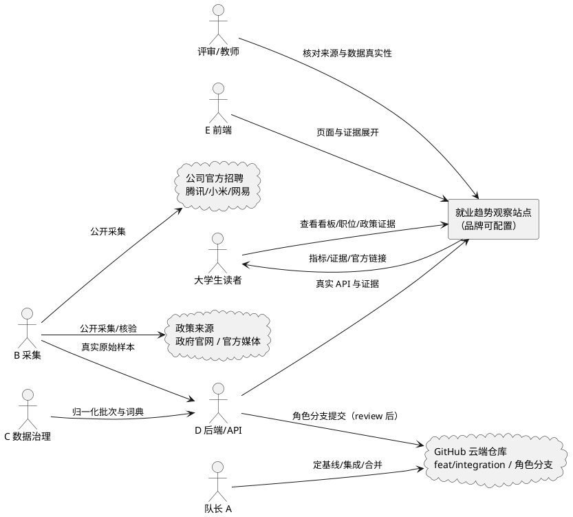
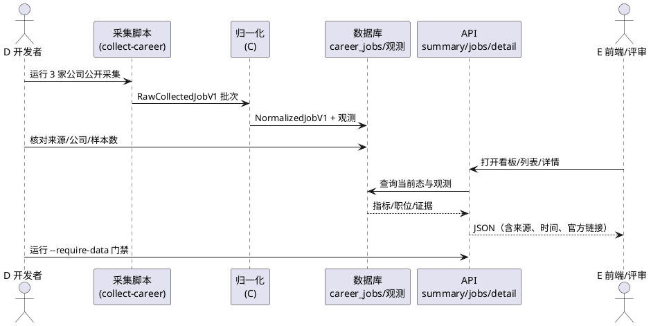
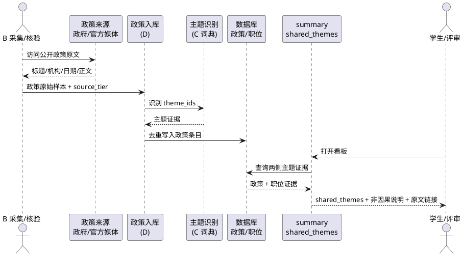
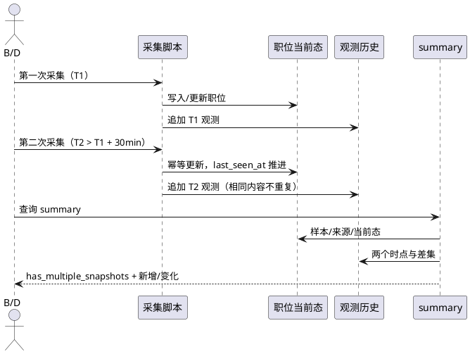
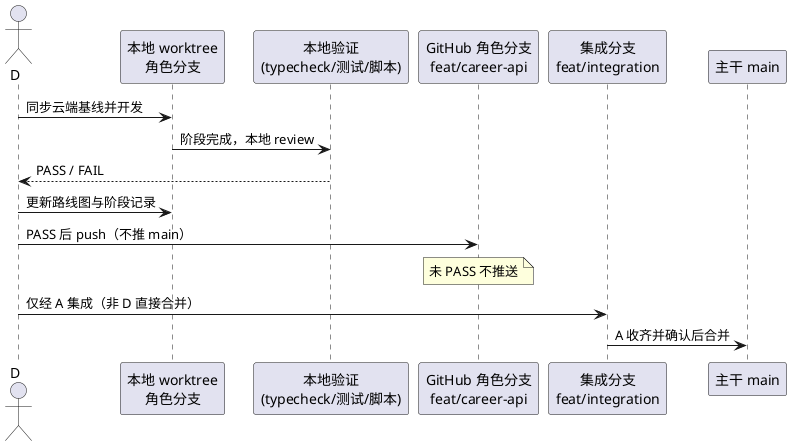

# AI+ 就业趋势观察平台：增量需求规格（2026-11-17）

> 文档状态：待评审（Draft，供队长与 A/B/C/E 确认）
> 适用角色：D（后端与 API，GitHub `goatzxr`，群昵称“怪物”）
> 权威基线：`origin/feat/integration` @ `21d07eb`（2026-11-17 22:32 +0800）
> 本地现状：`HEAD` @ `e2f777c`，落后云端 4 个提交；工作区存在 B 采集线未提交改动
> 需求口径来源：云端 `ROADMAP.md`「跨角色未解决任务（云端标记，2026-11-17）」表 + 队长 2026-11-17 群内指令
> 文档边界：只定义“做什么、验收什么”，不规定类名、表结构、函数签名和实现顺序；不修改任何业务代码

---

## 0. 使用约束

1. 本规格是**增量规格**，不重复描述已合入 `feat/integration` 的 D1 成果（SQL repository、幂等 ingest、`career-insights.ingest` 队列、三个 GET API）。D 角色不得重复实现这些能力。
2. 云端仓库与云端 `ROADMAP.md` 是唯一权威口径。动手前必须先 `git fetch` 并同步云端；本地落后时的验收结论无效。
3. 本规格用 EARS 句式书写。EARS 在本项目中的五种用法：
   - 通用：系统应当……
   - 事件驱动：当……时，系统应当……
   - 状态驱动：当系统处于……状态时，系统应当……
   - 可选特性：如果启用……，系统应当……
   - 异常/禁止：如果……，则系统应当……；系统不得……
4. 标为 P0 的条目是评审前必须完成；P1 是主线完成后才做；「明确不做」不得以任何理由夹带。
5. 本规格中的时间、数量、路径均以 2026-11-17 实测为准；执行前需复核一次。

---

## 1. 组件定位

### 1.1 核心职责

本组件负责把现成的 AI 内容平台改造成「AI + 就业趋势观察」站点，用公开招聘与政策证据回答“企业在招什么、政策在支持什么、学生该补什么”。

### 1.2 核心输入

1. 公司官方招聘来源：腾讯、小米、网易的公开职位 JSON/页面（B 的采集线）。
2. 政策来源：优先政府官网；不可达时使用可访问的官方媒体（新华网/人民网/中新网等）作为降级来源（B 的采集线）。
3. 归一化后的职位批次 `CareerObservationBatchV1`（C 的归一化与词典）。
4. 站点品牌配置与文案：`site/site.ts`、`site/brand/**`（A 的写集）。
5. 队长指令与云端路线图：阶段、门禁、推送与合并规则。
6. 用户/评审的浏览器访问：就业看板、职位详情、政策证据。

### 1.3 核心输出

1. 真实职位当前态与周期观测：`career_jobs`、`career_job_observations`。
2. 就业看板 API：`/api/site/career-insights/summary`、`/jobs`、`/jobs/:id`。
3. 政策证据与「政策—岗位共同方向」：`shared_themes` + 两侧可点击证据。
4. 学生可读的页面：`/career-insights` 看板与职位详情页。
5. 可追溯证据：来源、采集时间、官方原文链接、观测记录、采集日志。
6. 阶段路线图与 Git 提交记录：`docs/roadmaps/career-api-roadmap.md`、角色分支提交。

### 1.4 职责边界

本组件**不负责**：

1. 采集器实现与来源适配（B 的写集 `collector/**`）；D 只消费 B 的采集结果。
2. 归一化、去重、技能/主题词典与指标公式（C 的写集 `data/**`、`fixtures/**`）；D 只能调用，不得改口径。
3. 前端页面与视觉（E 的写集 `web.tsx`、`web/**`）；D 只提供 API 与字段语义。
4. 站点品牌文件、模块注册、`package-lock.json`、Dockerfile（A 的写集）；D 只提出配置需求并验收。
5. 多行业、账号体系、简历匹配、录用概率、长期预测、综合评分。
6. 绕过登录、验证码、反爬或付费墙。
7. 使用 AIHOT 名称与 Logo；编造职位、政策、历史快照或采集日志。

---

## 2. 领域术语

**就业HOT**
: 本项目的候选站名（工作名），指“AI + 就业趋势观察”站点；最终名称未确认，必须集中可配置。

**AI + 就业趋势观察**
: 用公开招聘与政策公开文本，展示当前岗位结构、技能需求、学生友好度和政策共同方向的产品定位；不是招聘平台，也不是预测系统。

**真实样本**
: 来自可公开访问的官方招聘页/官方政策页/官方媒体，且保留来源名称、原文链接和采集时间的职位或政策记录；fixture 与人工编造内容不算真实样本。

**观测时点（快照）**
: 一次成功采集在 `fetched_at` 上形成的批次；同一职位可被多次观测，观测历史用于判断“平台首次发现”和字段变化。

**导入样本（verified_import）**
: 自动采集不可用时，经人工核验来源与内容的真实快照；必须在数据与页面上标明“导入”，不得冒充自动采集。

**共享主题（shared_theme）**
: 同一 `theme_id` 在政策证据与职位证据两侧都出现时形成的方向对照；只表示文本方向呼应，不表示因果。

**来源层级（source_tier）**
: 政策来源的可信层级，例如政府官网、官方媒体、其他公开来源；降级来源必须显式标注，不得与政府原文混同。

**观察窗新增职位**
: 后一快照首次出现、且未出现在前一快照的职位；只代表本平台首次发现，不等于市场净增。

---

## 3. 角色与边界

### 3.1 核心角色

- 大学生读者：查看岗位结构、技能需求、学生友好岗位、政策方向与准备建议。
- 评审/指导教师：核对来源、证据链、数据真实性与页面可用性。
- 队长（A，Seevence）：定阶段、定品牌、做集成与最终合并决策。
- B：数据源采集；提供 3 家公司 + 2 个政策源的真实样本。
- C：归一化、去重、词典与指标口径；提供可消费的真实样本。
- D（本文档负责人）：后端与 API；负责真实数据入库、政策证据、`shared_themes`、时间口径与验收脚本。
- E：前端与演示；负责真实数据页面、证据展开、响应式与截图。

### 3.2 外部系统

- 腾讯官方招聘（`careers.tencent.com` 公开 JSON）：职位来源。
- 小米官方招聘（`hr.xiaomi.com` 公开 JSON）：职位来源。
- 网易官方招聘（`hr.163.com` 公开 JSON）：职位来源；分页当前失效。
- 政府政策官网（`.gov.cn`）：首选政策来源；本机当前不可达。
- 官方媒体（新华网/人民网/中新网等）：政策降级来源；必须以 `source_tier` 标注“官方媒体解读”。
- GitHub（`seevence/AIHOT`）：云端仓库、分支与评审载体。

### 3.3 交互上下文



图中只表达交互关系，不表达内部模块、数据库与接口参数。

---

## 4. 优先级与 ROADMAP 映射

### 4.1 P0：评审前必须完成

| 需求组 | 条目 | 对应 ROADMAP | 负责人 |
|---|---|---|---|
| 品牌与定位 | BRAND-01～06 | ROADMAP §6/§9「正式站名与一句话定位」 | A（D 提需求、验收） |
| 真实职位闭环 | D01-01～10 | D-01、A-01、E-01、B-01、C-01 | D（B/C/E/A 配合） |
| 政策证据与共同方向 | D02-01～03、05～12 | D-02、B-01、CD-01 | D / C（B/E/A 配合） |
| 观测时点与时间口径 | OBS-01～06 | A/B/C/D/E 第二次采集、CD-01 | B / D / C / E |
| 交付流程与 Git 门禁 | GIT-01～10 | 队长 2026-11-17 指令、`docs/team-startup.md` §6 | D / 全员 |

### 4.2 P1：主线完成后才做

| 需求组 | 条目 | 对应 ROADMAP | 负责人 |
|---|---|---|---|
| 政府源恢复后优先切回 | D02-04 | D-02 后续 | B |
| 来源覆盖历史面板/逐源趋势 | D02-13 | D-02 扩展 | D / E |
| MCP 工具名前缀与新品牌对齐 | BRAND-07 | §9 品牌 | A |
| 全站次级文案/日报周报口径统一 | BRAND-08 | §9 品牌 | A / E |
| 公司扩到 5–8 家、政策源 3–5 个 | — | ROADMAP P1 | B |
| 技能词典扩到 50+、CSV 导出、政策日报/周报、分享图、真实备份恢复 | — | ROADMAP P1 | B/C/E/A |
| 手机详情与筛选空态截图、3010 端口说明、hydration 复验 | — | E-02 | E |

### 4.3 明确不做

1. 多行业同时上线、全行业岗位覆盖、综合招聘平台爬取。
2. 简历上传、岗位匹配打分、录用概率预测、用户账号体系。
3. 绕过登录、验证码、反爬或付费墙。
4. 用大模型自由生成行业数字、因果关系或“未来必火”结论。
5. 原生 App、复杂个性化推荐、长期预测模型、完整运营平台。
6. 为评审临时编造历史岗位、政策、增长率或采集日志。
7. 使用 AIHOT 名称与 Logo；把 fixture 或 `synthetic-*` 样例当真实数据。
8. 把单次快照包装成趋势；把“未采集到”解释为职位下架或需求下降。
9. 把官方媒体的政策解读标成“政府原文”；输出“政策导致招聘变化”的因果结论。
10. 重写已合入的 D1 SQL repository、队列和真实 API。

---

## 5. DFX 约束

### 5.1 性能

1. 在 100 条真实职位样本、本地 Docker 环境，`summary` API p95 应当 ≤ 800 ms；`jobs` 列表 p95 应当 ≤ 500 ms。达不到时必须记录实测值并在交付说明中标注。
2. 页面首屏不得因逐条查询证据产生 N+1 放大；单个看板的证据查询次数应当与指标维度数量同阶。
3. 采集脚本单来源单次运行应当 ≤ 5 分钟；超时必须可中止并保留已入库数据。

### 5.2 可靠性

1. 采集失败不得删除或回滚既有职位与观测；`last_seen_at` 不因失败而推进。
2. 同一批次重复执行必须幂等：职位不重复、精确观测不重复。
3. 数据库不可用时 API 应当返回 `503 data_unavailable`，不得返回空列表或 200 冒充成功。
4. 至少保留两个真实观测时点；不足两个时点时必须显式返回 `insufficient_data`。

### 5.3 安全性

1. 只访问公开页面，不绕过登录、验证码或访问控制。
2. 公开 API 不返回 `raw_text` 全文、原始 HTML、Cookie、堆栈、密钥或个人数据。
3. 仓库不得提交 `.env`、密钥、`.data/`、个人信息。
4. 采集 User-Agent 使用本站自己的标识，不冒用他人站点。

### 5.4 可维护性

1. 每次采集必须可追溯：来源、`fetched_at`、`collector_version`、成功/失败原因。
2. 每个阶段完成后更新 `docs/roadmaps/career-api-roadmap.md`，记录范围、验证命令、review 结论与遗留。
3. 指标定义、词典版本、契约版本必须随响应返回，便于复核。
4. 关键操作保留可复现命令；验收结果写入 PR/提交说明。

### 5.5 兼容性

1. 契约 `0.1` 只允许新增可选字段；删除、改名、改类型、改枚举、改指标含义必须经 A/C/D/E 评审并同步 B。
2. 真实样本验收通过后冻结 `contract_version=1.0`，之后不改指标含义。
3. 品牌名变更不得隐式改变公开接口标识（路由、`mcpPrefix`、`interfaceVersion`）；如需改，单独评审并记录。

---

## 6. 核心能力（EARS）

### 6.1 品牌与站点定位

> 目标：把 `MyHOT / AI 行业动态` 切换为可替换的「就业HOT / AI + 就业趋势观察」定位；名称集中配置，读者可见面不出现 AIHOT 名称与 Logo。
> 现状事实：`site/site.ts:23` 为 `MyHOT`；`site/site.ts:73` 为“由 AIHOT 开源框架驱动”；`site/site.ts:81` 的 `poweredBy` 指向 AIHOT；`site/changelog.json:10` 出现 AIHOT；`docs/customize.md:102` 已明确“请不要使用 AIHOT 的名字和 Logo”。

#### 6.1.1 业务规则

1. **BRAND-01 品牌单一配置源**
   - 需求（EARS）：系统应当从单一品牌配置源读取站名、行业定位词与一句话描述，使维护者只改一处即可让导航、页面标题、分享图、RSS、`llms.txt`、后台和结构化数据同步生效。
   - 验收：修改品牌配置中的站名 → 重新构建后，首页标题、导航字标、分享卡片、RSS 标题、`llms.txt`、后台标题均显示新名称，且无需修改页面组件。
   - 优先级/负责人/ROADMAP：P0 / A / §9。

2. **BRAND-02 默认名称与定位可替换**
   - 需求（EARS）：系统应当以“就业HOT”为默认候选站名、以“AI + 就业趋势观察”为默认行业定位，并允许通过配置整体替换，不得把名称写死在页面、提示词、分享图模板或接口文案中。
   - 验收：把默认名称替换为第二个候选名 → 全站品牌承载面同步变化，代码中不存在第二处硬编码站名。
   - 优先级/负责人/ROADMAP：P0 / A / §9。

3. **BRAND-03 派生标识随配置**
   - 需求（EARS）：当品牌名变更时，系统应当让 `organization.name`、`crawlerName`、报告报头、SEO 标题、分享卡片和关于页标题随配置派生或显式配置，禁止残留 `MyHOT`。
   - 验收：全仓检索 `MyHOT` → 读者可见路径与运行时输出中无命中；结构化数据、抓取 UA、报头均使用新名称。
   - 优先级/负责人/ROADMAP：P0 / A / §9。

4. **BRAND-04 去 AIHOT 品牌**
   - 需求（EARS）：当构建或渲染站点时，读者可见面不得出现 AIHOT 名称、AIHOT Logo 或指向 `aihot.news` 的品牌链接；开源归属只保留在 `LICENSE`、`NOTICE`、`README` 等非读者界面。
   - 验收：首页、页脚、侧栏、“我的”页、关于页、分享图、RSS、`llms.txt`、changelog 中无 AIHOT 名称与 Logo；`NOTICE`/`LICENSE` 的归属声明保留。
   - 优先级/负责人/ROADMAP：P0 / A / §6、§9。

5. **BRAND-05 定位文案最小面**
   - 需求（EARS）：系统应当在首页标题、首页描述、`tagline`、关键词、关于页标题与主文案中表述“AI + 就业趋势观察、面向大学生”，不得继续以“AI 行业动态 / AI 日报”作为主口径。
   - 验收：打开首页与关于页 → 首屏文案指向就业与岗位/政策证据；浏览器标题与分享卡片不出现“AI 行业动态”主标题；文案不包含预测或保证性结论。
   - 优先级/负责人/ROADMAP：P0 / A / §9。

6. **BRAND-06 名称未定不阻塞交付**
   - 需求（EARS）：如果最终站名尚未确认，则系统仍应当以可替换配置运行，且所有品牌承载面只依赖该配置；确认后一处修改即可全站生效。
   - 验收：在未确认名称的情况下完成构建与页面验收；替换名称后无需改代码即可再次通过构建。
   - 优先级/负责人/ROADMAP：P0 / A / §9。

7. **BRAND-07 MCP 前缀显式决策（P1）**
   - 需求（EARS）：如果品牌切换涉及 MCP 工具名前缀，则应当把前缀作为独立配置项显式决策并记录兼容影响，不得由站名自动派生。
   - 验收：配置中保留独立 `mcpPrefix`；变更前后工具名清单与兼容说明写入交付记录。
   - 优先级/负责人/ROADMAP：P1 / A / §9。

8. **BRAND-08 次级文案统一（P1）**
   - 需求（EARS）：当主线品牌切换完成后，系统应当把日报/周报/月报、主题页、Agent 接入页、反馈页等次级文案统一到就业定位，不再残留 AI 资讯站说法。
   - 验收：全站巡检无“AI 热点榜 / AI 日报 / AI 行业动态”等旧主口径；报告与分享图口径一致。
   - 优先级/负责人/ROADMAP：P1 / A、E / §9。

#### 6.1.2 交互流程

品牌切换是构建期配置，不产生运行时交互；验收路径为：修改品牌配置 → 重新构建 → 逐面检查（首页/关于/分享图/RSS/llms/后台）→ 通过后进入 D-01 验收。

#### 6.1.3 异常场景

1. **品牌配置只改了一部分**
   - 触发条件：站名已改，但 `organization.name`、`crawlerName`、报头或分享图仍为旧值。
   - 系统行为：构建检查或人工巡检发现不一致，阻断验收。
   - 用户感知：页面出现两个站名，或搜索结构化数据仍是旧名。
2. **误改公开接口标识**
   - 触发条件：品牌替换时顺带改了 `mcpPrefix`、路由或 `interfaceVersion`。
   - 系统行为：按兼容性约束回退，单独评审后再改。
   - 用户感知：已接入的 MCP/Agent 工具名失效（上线后）。
3. **开源归属被完全删除**
   - 触发条件：为去品牌把 `LICENSE`/`NOTICE` 的归属也删掉。
   - 系统行为：恢复非界面归属声明，仅移除读者界面的品牌展示。
   - 用户感知：无界面变化，合规风险消除。

---

### 6.2 D-01 真实职位数据闭环

> 目标：真实职位经数据库 → API → 页面，字段、证据与 `--require-data` 验收通过。
> 现状事实：腾讯/小米/网易公开 JSON 已跑通，本地入库 70 条真实职位；网易分页失效；SQL repository、队列、真实 API 已合入，D 不重复实现。

#### 6.2.1 业务规则

1. **D01-01 三家公司真实入库**
   - 需求（EARS）：当执行真实采集时，系统应当将至少 3 家公司的公开职位写入 `career_jobs`，每条至少包含 `source_key`、`job_key`、`company_name`、`title`、`official_url`、`fetched_at`、`collector_version`。
   - 验收：采集后查询数据库 → 至少 3 个不同 `source_key`、至少 3 个不同 `company_name`、样本数 > 0；每条记录有官方链接与采集时间。
   - 优先级/负责人/ROADMAP：P0 / D（B 提供数据）/ D-01、B-01。

2. **D01-02 幂等去重**
   - 需求（EARS）：当同一来源重复采集时，系统应当按 `(source_key, job_key)` 不产生重复职位；内容未变时只推进 `last_seen_at`；相同 `(job_id, observed_at, content_hash)` 不得重复写入观测。
   - 验收：同一来源连续执行两次采集 → 职位总数不翻倍；第二次返回的 `duplicates`/`updated` 与预期一致；观测表无重复三元组。
   - 优先级/负责人/ROADMAP：P0 / D / D-01。

3. **D01-03 真实数据 API**
   - 需求（EARS）：当数据库中存在真实职位时，`summary` 应当返回 `sample_size > 0`、`company_count >= 3`、`source_count >= 3`、`data_origin` 为 `live` 或 `verified_import`，且 `as_of`/`first_observed_at`/`last_observed_at` 为 UTC `Z` 时间。
   - 验收：`GET /api/site/career-insights/summary` → 字段满足上述条件；`GET /jobs` 的 `items` 非空、`total` 与分页一致。
   - 优先级/负责人/ROADMAP：P0 / D / D-01、CD-01。

4. **D01-04 字段与证据完整**
   - 需求（EARS）：当展示职位列表或详情时，系统应当提供公司、标题、职族、城市、学历、用工类型、应届友好、技能及原文证据、`published_at`、`first_seen_at`、`last_seen_at` 和官方链接；未知值保持 `unknown`/`null`/`[]` 并明确标注。
   - 验收：任取一条真实职位 → 上述字段齐全；`unknown` 不被显示为“不限”或 0；技能能定位到 `evidence_text`。
   - 优先级/负责人/ROADMAP：P0 / D（E 渲染）/ D-01、E-01。

5. **D01-05 证据可回溯**
   - 需求（EARS）：当用户点击任一指标证据或职位详情时，系统应当返回可打开的观测记录（`observed_at`、`content_hash`、`source_url`、原文摘录）和官方职位链接；公开 API 不得返回 `raw_text` 全文。
   - 验收：从指标证据进入职位详情 → 可见至少 1 条观测记录；官方链接可打开；响应中无 `raw_text` 字段。
   - 优先级/负责人/ROADMAP：P0 / D / D-01。

6. **D01-06 空库门禁**
   - 需求（EARS）：当数据库为空、职位列表为空或详情无观测证据时，`scripts/check-career-integration.ts --require-data` 应当失败；当真实数据满足条件时应当通过。
   - 验收：空库执行 `--require-data` → 非 0 退出并给出具体原因；真实数据执行 → 全部检查通过。
   - 优先级/负责人/ROADMAP：P0 / A（门禁代码）、D（数据）/ A-01。

7. **D01-07 页面真实渲染**
   - 需求（EARS）：当浏览器打开 `/career-insights` 时，页面应当以真实 API 渲染，不引用 fixture，并显示样本范围、观测时间、来源数、公司数与数据局限。
   - 验收：真实库运行时页面 200；页面无“联调样例（非真实数据）”标识；样本数、来源数、观测时间与 API 一致；桌面与手机均可完成浏览。
   - 优先级/负责人/ROADMAP：P0 / E（D 提供 API）/ D-01、E-01。

8. **D01-08 单快照不冒充趋势**
   - 需求（EARS）：当系统只有 1 个观测时点时，`observed_new_jobs` 应当返回 `status=insufficient_data`、`value=null`，`has_multiple_snapshots=false`，页面不得展示涨跌或“新增趋势”。
   - 验收：单快照调用 summary → 上述字段成立；页面显示“观测不足”，无趋势图。
   - 优先级/负责人/ROADMAP：P0 / D、E / D-01。

9. **D01-09 导入样本标注**
   - 需求（EARS）：当使用人工核验快照补足来源时，系统应当把 `data_origin` 标记为 `verified_import`，并在页面标明“导入”及核验时间；禁止标为 `live`。
   - 验收：导入批次写入后 summary/页面显示 `verified_import` 与“导入”标识；自动采集不出现该标识。
   - 优先级/负责人/ROADMAP：P0 / D、B / B-02、D-01。

10. **D01-10 不重复实现**
    - 需求（EARS）：系统已经具备的 SQL repository、幂等 ingest、队列和三个 GET API 不得被重复实现或改写；本阶段只允许在既有实现上补齐真实数据、政策与时间口径缺口。
    - 验收：对比 `feat/integration` → 无重复的 repository/queue/API 文件；提交说明列出增量点。
    - 优先级/负责人/ROADMAP：P0 / D / D-01。

#### 6.2.2 交互流程（D-01 最小闭环）



#### 6.2.3 异常场景

1. **某公司采集失败**
   - 触发条件：官方接口超时、改版、限流或分页失效。
   - 系统行为：保留上次成功数据，记录失败来源与原因；不推进该来源 `last_seen_at`；不以失败推断下架。
   - 用户感知：来源状态显示失败/陈旧，样本数与来源覆盖如实下降。
2. **去重键冲突**
   - 触发条件：同一官方职位 ID 在不同来源或不同 URL 下重复出现。
   - 系统行为：按 `(source_key, job_key)` 去重；跨来源重复保留来源归属，不静默合并。
   - 用户感知：列表不重复展示同一来源职位。
3. **真实样本不足 3 家**
   - 触发条件：D2 结束时自动来源仍不足 3 家。
   - 系统行为：保留已成功的自动闭环；其余使用人工核验快照并标为“导入”。
   - 用户感知：页面显示“导入”标识与核验时间，不冒充自动采集。
4. **数据库不可用**
   - 触发条件：连接失败、迁移未应用或权限错误。
   - 系统行为：返回 `503 data_unavailable`；页面显示“数据尚未就绪”，不渲染空列表冒充成功。
   - 用户感知：错误态与排查提示。

---

### 6.3 D-02 政策证据与共同方向

> 目标：政策可存储、可查询、可回溯；`shared_themes` 来自真实政策证据；来源降级口径与“共同方向不等于因果”约束落地。
> 现状事实：`backend/summary.ts:286` 写死 `shared_themes: []`；`backend/summary.ts:273` 固定提示“政策证据尚未接入”；career 模块只有 `career_jobs` / `career_job_observations` 两张表；核心库已有 `sources/articles/publications`，可承载政策文章但需映射 `PolicyEvidenceRefV1`。

#### 6.3.1 业务规则

1. **D02-01 政策持久化**
   - 需求（EARS）：当采集或导入政策条目时，系统应当持久化至少 `policy_item_id`、`title`、`issuer`、`published_at`（`YYYY-MM-DD`）、`official_url`、`source_key`、`source_tier`、`theme_ids`、`evidence_excerpt`，并能按来源与 `policy_item_id` 去重后查询。
   - 验收：写入 2 条政策 → 可通过 API/查询取得上述字段；重复导入不产生重复条目；空字段不被伪造。
   - 优先级/负责人/ROADMAP：P0 / D（C 提供主题识别）/ D-02。

2. **D02-02 两个政策来源**
   - 需求（EARS）：系统应当接入至少 2 个可访问的政策来源，各至少 1 条真实样本，并保留来源名称、原文链接与发布时间。
   - 验收：政策列表 → 至少 2 个不同 `source_key`、至少 2 条可打开原文的记录。
   - 优先级/负责人/ROADMAP：P0 / B（D 入库）/ B-01、D-02。

3. **D02-03 来源降级口径**
   - 需求（EARS）：如果政府官网不可达（例如本机代理下 `.gov.cn` 握手失败），则系统应当使用可访问的官方媒体（新华网/人民网/中新网等）作为政策来源，并在数据与页面用 `source_tier` 明确标注“官方媒体解读”，不得表述为“政府原文”。
   - 验收：降级来源政策 → 详情显示来源层级“官方媒体解读”与原文链接；接口返回 `source_tier`；页面无“政府原文”措辞。
   - 优先级/负责人/ROADMAP：P0 / B、D、E / B-01、D-02。

4. **D02-04 政府源恢复后优先切回（P1）**
   - 需求（EARS）：当政府官网恢复可达时，系统应当优先恢复政府来源，并保留既有官方媒体样本的来源层级，不混同、不回填。
   - 验收：新增政策来自政府源时 `source_tier` 为政府层级；旧样本层级不变。
   - 优先级/负责人/ROADMAP：P1 / B / D-02。

5. **D02-05 shared_themes 真实证据**
   - 需求（EARS）：当政策与职位在同一个 `theme_id` 上均有证据时，`summary.shared_themes` 应当返回该主题，包含 `policy_count`、`job_count` 以及政策侧和职位侧可点击证据；主题 ID 只能来自统一主题词典。
   - 验收：2 条政策 + 真实职位 → 至少 1 个共享主题；两侧证据可点击；计数与数据库一致；无证据主题不返回。
   - 优先级/负责人/ROADMAP：P0 / D（C 口径）/ D-02。

6. **D02-06 证据不足不误导**
   - 需求（EARS）：如果政策侧或职位侧证据为空，则 `policy_job_shared_themes` 应当返回 `status=insufficient_data`、`value=null`，并给出明确 warning；页面应当显示“证据不足”，不得显示“无共同方向”或 0。
   - 验收：空政策库调用 summary → 指标状态与 warning 成立；页面显示“证据不足”；不出现“无共同方向”结论。
   - 优先级/负责人/ROADMAP：P0 / D、E / D-02。

7. **D02-07 共同方向不等于因果**
   - 需求（EARS）：系统应当在 API `disclaimer`、页面标题说明和每张共享主题卡片上明确“仅表示政策方向与招聘需求的呼应，不表示因果关系”，不得输出“政策带动/导致招聘增长”等结论，也不得计算综合分。
   - 验收：summary 的 `policy_job_shared_themes.disclaimer` 与页面文案均包含非因果说明；全站无因果措辞与综合分。
   - 优先级/负责人/ROADMAP：P0 / D、E / D-02、ROADMAP §4.2。

8. **D02-08 未识别技能比例**
   - 需求（EARS）：当计算 `skill_demand_share` 时，系统应当同时返回没有任何已识别技能的职位数与占比（分母为样本数），未知技能不得补为已知技能。
   - 验收：真实样本 summary → 技能指标带 `unknown_count` 与 `unknown_ratio`；无技能职位数与数据库一致；页面/接口说明 unknown 含义。
   - 优先级/负责人/ROADMAP：P0 / D（C 口径）/ D-02。

9. **D02-09 来源覆盖变化**
   - 需求（EARS）：当两次采集之间某来源失败或条数变化时，系统应当保留上次成功状态并标记 `source_failed`/`stale_data`，展示来源覆盖数与变化说明；不得把未采集到解释为职位下架或需求下降。
   - 验收：模拟一个来源失败 → summary 出现 `source_failed` warning；该来源职位仍在库；页面显示来源覆盖变化，不显示“需求下降”。
   - 优先级/负责人/ROADMAP：P0（API + warning）/ D、C / D-02。

10. **D02-10 政策原文可跳转**
    - 需求（EARS）：当展示任一政策证据时，系统应当提供原文链接、发布机构、发布日期、来源层级和摘录，链接使用官方域名。
    - 验收：点击政策卡片 → 打开官方原文；机构/日期/层级/摘录可见；无死链。
    - 优先级/负责人/ROADMAP：P0 / E（D 提供字段）/ D-02。

11. **D02-11 空政策不静默**
    - 需求（EARS）：如果政策存储尚未建立或为空，则系统不得返回伪造政策、fixture 政策或静默的空列表；应当返回 `insufficient_data` 并给出明确 warning，替换当前写死的提示。
    - 验收：空政策状态下调用 summary → `shared_themes=[]` 且 `policy_job_shared_themes.status=insufficient_data`、warning 明确；无 `synthetic-policy-*` 出现在正式 API。
    - 优先级/负责人/ROADMAP：P0 / D / D-02。

12. **D02-12 契约冻结**
    - 需求（EARS）：当真实政策与职位样本验收通过后，系统应当把 `contract_version` 升级为 `1.0`，同步类型、OpenAPI、受影响测试与 B/C/D/E 影响说明；破坏性变更不得在冻结后引入。
    - 验收：契约文件、OpenAPI、测试、文档一致；`1.0` 后无删除/改名/改类型。
    - 优先级/负责人/ROADMAP：P0 / A、C、D / D-02。

13. **D02-13 来源覆盖历史面板（P1）**
    - 需求（EARS）：如果进入 P1 阶段，系统应当提供逐来源的采集历史、成功率和条数变化视图，便于评审核对覆盖范围。
    - 验收：后台/页面可按来源查看最近两次采集状态与条数。
    - 优先级/负责人/ROADMAP：P1 / D、E / D-02 扩展。

#### 6.3.2 交互流程（D-02 政策证据）



#### 6.3.3 异常场景

1. **政策源全部不可达**
   - 触发条件：政府官网与官方媒体均无法访问。
   - 系统行为：不生成假政策；保留空态与 `insufficient_data`；记录失败原因，等待人工核验导入。
   - 用户感知：页面显示“政策证据不足”，不显示编造主题。
2. **政策被误判为非政策内容**
   - 触发条件：列表页混入新闻、广告或非政策解读。
   - 系统行为：缩小 URL 范围与精确分类；人工复核后剔除；不扩大抓取范围。
   - 用户感知：政策条目减少但来源更准确。
3. **主题误匹配**
   - 触发条件：关键词命中但语义不符（例如“AI 人才”误判为“人才培养”）。
   - 系统行为：保留原文证据，允许人工修正 `theme_ids`；指标声明词典版本。
   - 用户感知：共享主题附证据摘录，评审可核对。
4. **政策日期缺失或格式不一**
   - 触发条件：原文只有“2026年11月”或发布时间在正文。
   - 系统行为：保持 `published_at` 为 `null` 或按原文精确到日；不得用采集时间冒充。
   - 用户感知：页面显示“发布日期未知”，不显示错误日期。

---

### 6.4 两个观测时点与时间口径

> 目标：形成两个真实观测时点；同一来源连续采集不重复；新增/变化来自真实快照；时间统一 UTC `Z`。
> 现状事实：`career_job_observations` 已按 `(job_id, observed_at, content_hash)` 幂等；summary 仅在存在两个不同 `observed_at` 时计算新增。

#### 6.4.1 业务规则

1. **OBS-01 两个观测时点**
   - 需求（EARS）：当完成第一次真实采集后，系统应当在至少 30 分钟之后（建议次日同一时段）对同一来源再次采集，形成两个不同 `fetched_at` 的观测时点；至少 3 家公司均参与两次采集。
   - 验收：观测表出现两个不同 `observed_at`；summary `has_multiple_snapshots=true`；两次采集均有来源与时间记录。
   - 优先级/负责人/ROADMAP：P0 / B（采集）、D（写入）/ 全员第二次采集。

2. **OBS-02 第二次不重复**
   - 需求（EARS）：当执行第二次采集时，系统不得新增重复职位；新增职位应当是前后快照职位集合的差集，而不是 `first_seen_at` 的简单筛选。
   - 验收：第二次采集后职位总数不因重复而膨胀；`observed_new_jobs` 的证据只包含差集中的职位。
   - 优先级/负责人/ROADMAP：P0 / D、C / 全员第二次采集。

3. **OBS-03 新增口径**
   - 需求（EARS）：当存在两个时点且没有新增职位时，系统应当返回真实计算的 `value=0` 并明确显示“本次未发现新增”；当不足两个时点时，应当返回 `insufficient_data`，不得返回 0。
   - 验收：两次相同快照 → `value=0`、`status=ok`、证据为空；单快照 → `value=null`、`insufficient_data`。
   - 优先级/负责人/ROADMAP：P0 / D / D-01、CD-01。

4. **OBS-04 时间统一**
   - 需求（EARS）：系统所有公开时间戳（`fetched_at`、`observed_at`、`first_seen_at`、`last_seen_at`、`as_of`）应当为 UTC ISO-8601 且以 `Z` 结尾；政策 `published_at` 应当为 `YYYY-MM-DD`（date-only，来自原文），不得用采集时间冒充。
   - 验收：遍历 API 响应 → 无本地时区偏移、无毫秒格式不一致；政策日期为 10 位日期；采集时间不填入 `published_at`。
   - 优先级/负责人/ROADMAP：P0 / C、D / CD-01。

5. **OBS-05 前端可读化**
   - 需求（EARS）：系统应当把 UTC 时间转换为读者可读的本地时间或相对时间，并在需要时标注时区；不得把原始 ISO 字符串作为唯一展示。
   - 验收：看板/详情显示“11月17日 22:30”或“2 小时前”；政策显示发布日期而非采集时间。
   - 优先级/负责人/ROADMAP：P0 / E / CD-01、E-01。

6. **OBS-06 快照真实性**
   - 需求（EARS）：系统不得回填历史快照、伪造 `observed_at` 或用采集时间冒充官方发布时间；只有职位内容变化才产生新的 `content_hash` 观测。
   - 验收：对比采集日志与观测表 → 时间一致；相同内容重复采集不产生新观测；`published_at` 只来自官方页面。
   - 优先级/负责人/ROADMAP：P0 / B、D / CD-01。

#### 6.4.2 交互流程（两个观测时点）



#### 6.4.3 异常场景

1. **第二次采集全部失败**
   - 触发条件：网络、代理或来源改版。
   - 系统行为：保留第一次快照；`has_multiple_snapshots=false`；不生成趋势。
   - 用户感知：页面显示“仅有 1 次观测”，隐藏新增/变化图。
2. **两次采集时间过近**
   - 触发条件：间隔小于 30 分钟，无法形成有意义的观察窗。
   - 系统行为：仍如实记录两个 `observed_at`，但验收说明标注观察窗过短；建议重新采集。
   - 用户感知：页面显示观测时间，不夸大变化。
3. **同一职位内容变化**
   - 触发条件：标题/职责/要求更新导致 `content_hash` 变化。
   - 系统行为：生成新观测，更新当前态；不改 `first_seen_at`。
   - 用户感知：详情可见多条观测记录。

---

### 6.5 交付流程与 Git 门禁

> 目标：本地 review → 推云端角色分支 → 不进主干；阶段推进可追溯、可回退；并行子代理不降低质量。
> 队长原话（2026-11-17）：“在本地跑完 review 过没问题之后再推送到云端分支，先别进主干”“不用着急将代码并入分支”“可以多指派子代理加快任务但是不能牺牲质量”。

#### 6.5.1 业务规则（流程型 EARS）

1. **GIT-01 云端为基准**
   - 需求（EARS）：当开始任一开发阶段时，开发者应当先读取 `origin/feat/integration` 并以云端为基准；本地落后时必须先同步，不得在落后提交的树上直接给出验收结论。
   - 验收：`git log HEAD..origin/feat/integration` 为空后才开始阶段；提交基于最新云端。
   - 优先级/负责人/ROADMAP：P0 / D、全员 / 队长指令。

2. **GIT-02 写集隔离**
   - 需求（EARS）：当开始 D 阶段开发时，开发者应当使用独立 worktree/分支，只提交 `modules/career-insights/{server.ts,backend/**,migrations/**}`；不得把 B/C/E/A 的文件或未提交改动混入提交。
   - 验收：`git status` 与提交 diff 仅含 D 写集；B 的 `collector/*`、`scripts/collect-career.ts` 不被提交。
   - 优先级/负责人/ROADMAP：P0 / D / ROADMAP §6。

3. **GIT-03 本地路线图**
   - 需求（EARS）：开发前，开发者应当把分支路线图复制/更新到本地 `docs/roadmaps/career-api-roadmap.md`；每完成一个阶段应当更新阶段状态、验证命令、review 结论与遗留。
   - 验收：路线图阶段表与实际提交一致；每个阶段有独立记录。
   - 优先级/负责人/ROADMAP：P0 / D / 队长指令。

4. **GIT-04 阶段门禁**
   - 需求（EARS）：当阶段开发完成时，开发者应当先在本地执行类型检查、相关测试与集成脚本 review；PASS 后才能进入下一阶段，FAIL 必须修复并复验。
   - 验收：阶段记录包含命令、结果与 review 结论；无“未验证即进入下一阶段”。
   - 优先级/负责人/ROADMAP：P0 / D / 队长指令。

5. **GIT-05 推送时机**
   - 需求（EARS）：当本地 review PASS 后，开发者应当把提交推送到角色分支（`feat/career-api` 或当前角色分支），不得直接推送 `main`，也不得未经 A 同意直接并入 `feat/integration`。
   - 验收：远端只出现角色分支更新；`main` 无新提交；集成分支合并由 A 执行。
   - 优先级/负责人/ROADMAP：P0 / D / 队长指令。

6. **GIT-06 禁止强推**
   - 需求（EARS）：如果需要更新已推送的分支，开发者应当使用 `--force-with-lease`，不得覆盖他人提交；提交说明应当包含阶段、验证命令与数据真实性。
   - 验收：远端历史无他人提交被覆盖；提交信息可追溯。
   - 优先级/负责人/ROADMAP：P0 / D / `docs/team-startup.md` §6。

7. **GIT-07 提交内容**
   - 需求（EARS）：系统不得提交 `.env`、密钥、`.data/`、个人信息、fixture 冒充的真实数据或非 A 维护的 `package-lock.json`。
   - 验收：提交 diff 无敏感文件；`.gitignore` 生效。
   - 优先级/负责人/ROADMAP：P0 / 全员 / ROADMAP §6。

8. **GIT-08 子代理约束**
   - 需求（EARS）：当指派子代理并行开发时，提示词应当限定写集、禁止编造数据、要求本地验证；主代理应当复核子代理产出，质量门禁不得降低。
   - 验收：子代理提示词与产出可追溯；复核记录存在。
   - 优先级/负责人/ROADMAP：P0 / D / 队长指令。

9. **GIT-09 只推已验收成果**
   - 需求（EARS）：如果代码未通过本地 review 或验收脚本，则不得推送到云端；推送前应当检查 `git status`、`git diff` 与验证结果。
   - 验收：推送提交均有对应 review 记录；无“边写边推”。
   - 优先级/负责人/ROADMAP：P0 / D / 队长指令。

10. **GIT-10 主干冻结**
    - 需求（EARS）：`main` 只允许在 A 完成集成并经队长确认后进入；角色分支不得直接向 `main` 提 PR。
    - 验收：`main` 无角色分支直接提交；合并记录由 A 执行。
    - 优先级/负责人/ROADMAP：P0 / A、全员 / ROADMAP §6。

#### 6.5.2 交互流程（本地到云端）



#### 6.5.3 异常场景

1. **本地工作区混入他人改动**
   - 触发条件：主工作区同时存在 B 的 collector 未提交改动。
   - 系统行为：改用独立 worktree；提交前按路径检查，不 `git add -A`。
   - 用户感知：提交干净，无跨角色污染。
2. **云端领先导致冲突**
   - 触发条件：本地落后 4 个提交且改动同一文件。
   - 系统行为：先 fetch/rebase 或合并云端，再重跑验证；不覆盖云端。
   - 用户感知：PR 可正常评审。
3. **review FAIL**
   - 触发条件：类型检查、测试或门禁脚本失败。
   - 系统行为：修复后复验；保持阶段分支，不进入下一阶段、不推送。
   - 用户感知：阶段状态仍为“进行中”。

---

## 7. 数据约束

### 7.1 职位（CareerJob）

1. **source_key**：必填；同一来源稳定不变；与采集器定义一致。
2. **job_key**：必填；优先官方职位 ID，没有时使用规范化 URL 哈希；同一来源内唯一。
3. **company_name / title / official_url**：必填；`official_url` 使用官方域名。
4. **role_family**：必填；只能取契约枚举；无法判断时为 `unknown`，不得猜测。
5. **degree / employment_type / student_friendly**：必填；无法判断时为 `unknown`；“未写经验”不得解释为“经验不限”。
6. **locations / skills / skill_evidence**：可为空数组；技能必须能对应原文证据。
7. **published_at**：可空；只能来自官方页面；不得用采集时间冒充。
8. **first_seen_at / last_seen_at**：必填；`first_seen_at` 不随后续采集改变；`last_seen_at` 仅在成功采集时推进。
9. **唯一性**：`(source_key, job_key)` 唯一；跨来源重复保留各自来源归属。
10. **data_origin**：`live`（自动采集）/ `verified_import`（人工核验）/ `synthetic_fixture`（仅联调，不得进正式库）。

### 7.2 观测（CareerObservation）

1. **job_id**：必填；指向职位当前态。
2. **observed_at**：必填；UTC `Z`；等于该次采集的 `fetched_at`。
3. **content_hash**：必填；内容变化才变化。
4. **collector_version / source_url**：必填；可追溯。
5. **raw_excerpt**：必填；公开 API 最多返回 500 字符，不返回全文。
6. **唯一性**：`(job_id, observed_at, content_hash)` 唯一；精确重试不新增观测。

### 7.3 政策（PolicyItem，逻辑对象）

1. **policy_item_id**：必填且唯一；来自来源 ID 或规范化 URL 哈希。
2. **title**：必填；来自原文标题。
3. **issuer**：必填；发布机构名称，不得编造。
4. **published_at**：可空；`YYYY-MM-DD`；来自原文；缺失时显示“发布日期未知”。
5. **official_url**：必填；官方域名；可打开原文。
6. **source_key / source_tier**：必填；`source_tier` 至少区分政府官网、官方媒体、其他公开来源。
7. **theme_ids**：可为空数组；只能来自统一主题词典；无法识别时为空，不猜测。
8. **evidence_excerpt**：必填；能支撑主题判断的原文摘录。
9. **去重**：按来源与 `policy_item_id` 去重；同一政策多来源转载保留来源层级，不合并为一条“政府原文”。

### 7.4 共享主题（SharedTheme）

1. **theme_id**：必填；来自词典。
2. **policy_count / job_count**：必填；分别按政策条目与去重职位计数。
3. **policies / jobs**：两侧证据均非空才返回该主题；每条证据含标题、机构/公司、日期、官方链接、摘录。
4. **非因果**：响应必须携带免责声明；不得把 `theme_id` 编码为分数或排名。

### 7.5 时间格式

1. 所有 `timestamptz` 对外序列化为 UTC ISO-8601，以 `Z` 结尾。
2. 政策 `published_at` 为 date-only；前端展示为本地可读日期。
3. 采集时间、观测时间、官方发布时间三者不得互相冒充。

---

## 8. 依赖、阻塞与降级

| 依赖/阻塞 | 影响条目 | 当前事实（2026-11-17） | 降级方案 | 决策/负责人 |
|---|---|---|---|---|
| 政策源可达性 | D02-02、D02-03、D02-05 | `.gov.cn` 本机全部不可达（代理 schannel 握手失败） | 使用新华网/人民网/中新网等官方媒体；`source_tier=official_media`，页面标“官方媒体解读”；仍不可达则人工核验导入并标 `verified_import` | B / 队长 |
| B-01 真实采集样本 | D01-01、D02-02、OBS-01 | 腾讯/小米/网易已跑通，入库 70 条；网易分页失效 | 按 `job_key` 去重；不足 3 家时启用备选公司（阿里/字节，需 Playwright）或人工核验导入；不伪造 | B / 队长 |
| C-01 归一化与指标复验 | D01-03、D02-05、D02-08 | 真实样本的归一化/去重/指标未复验 | D 只调用 C 的 `normalizeRawJobs`/`validateNormalizedJobV1`/指标口径；C 未交付前不做指标结论 | C / D |
| 政策存储缺失 | D02-01、D02-05、D02-11 | career 模块只有 `career_jobs`/`career_job_observations`；核心库有 `sources/articles/publications` 可复用但需映射 `PolicyEvidenceRefV1` | 方案一：新增 career 政策迁移；方案二：复用 `publications` + 主题标签并建立只读映射。两案都需 A 契约/迁移评审；不得硬编码数组 | D / A |
| A-01 门禁加严 | D01-06 | 云端 `c666b46` 已加严 `--require-data`；本地落后 4 个提交 | 先同步云端再验收；否则空样本可能误通过 | A / D |
| 云端同步 | GIT-01、全部验收 | 本地 `e2f777c` 落后 `21d07eb` 4 个提交 | `git fetch` + rebase/merge 后重跑验证；不覆盖云端 | D |
| 工作区污染 | GIT-02 | 主工作区有 B 的 6 个未提交文件 | 独立 worktree；提交前按路径检查 | D |
| 时间格式差异 | OBS-04、CD-01 | 腾讯日期、网易 epoch ms、政策 date-only | 在归一化/契约层统一；政策保持 date-only；前端可读化 | C / D / E |
| 页面验收依赖 | D01-07、OBS-05 | E-01 依赖 D-01 | D 先提供真实 API，E 再出桌面/手机截图；不互相等待 | E / D |
| 旧库 schema 风险 | D02-01、D-01 | 若库应用过 `0153` 早期版本，改文件不会重跑 | 真实数据接入前重建库，或核验 `is_identity`/`column_default` | A / 运维 |
| 正式站名未定 | BRAND-01～06 | ROADMAP §9 未确认 | 默认“就业HOT”，全部走配置；确认后一处替换 | 队长 / A |

**阻塞判定规则**：以上任一阻塞未解除时，对应条目状态只能是“未开始/受阻”，不得以 fixture、硬编码或编造数据“先过验收”。

---

## 9. 最小验收路径

### 9.1 D-01 真实职位闭环（P0）

1. **同步云端**：`git fetch origin`；确认 `HEAD` 基于 `origin/feat/integration`；在独立 worktree 操作。
2. **应用迁移**：`0152`–`0155`；确认 `career_jobs`/`career_job_observations` 存在且 schema 与 fresh migration 一致。
3. **真实采集**：运行 `node scripts/collect-career.ts tencent-official-careers xiaomi-official-careers netease-official-careers`。
4. **核对入库**：至少 3 个 `source_key`、3 个 `company_name`、样本数 > 0；每条有官方链接与 `fetched_at`。
5. **API 验证**：`summary` 的 `sample_size/company_count/source_count` 与库一致；`jobs` 列表非空、分页一致；任取 `id` 打开详情，含观测记录与官方链接。
6. **页面验证**：`/career-insights` 真实渲染，无 fixture 标识；显示样本范围、观测时间、来源数与局限。
7. **门禁验证**：`node scripts/check-career-integration.ts --base http://localhost:3000 --require-data` 通过；另用空库验证必须失败。
8. **证据留存**：命令输出、API 响应摘要、页面截图、数据库计数写入阶段记录。

### 9.2 两个观测时点（P0）

1. 第一次采集完成后至少 30 分钟（建议次日同一时段）再次采集同一组来源。
2. 核对职位总数不翻倍；观测表出现两个不同 `observed_at`。
3. `summary.has_multiple_snapshots=true`；`observed_new_jobs` 有真实值（无新增时为 0）。
4. 记录两次采集时间、来源成功/失败、条数变化；不生成趋势结论。

### 9.3 D-02 政策证据（P0）

1. 确认政策存储方案（新增迁移或复用 `publications`），经 A 评审。
2. 接入 2 个可访问政策源，各至少 1 条真实样本；保留机构、日期、原文链接、`source_tier`。
3. 用统一主题词典识别 `theme_ids`；无识别结果保持空数组。
4. `summary.shared_themes` 返回至少 1 个两侧有证据的主题；证据可点击；空侧返回 `insufficient_data`。
5. 技能指标包含 `unknown_count`/`unknown_ratio`；来源失败显示 `source_failed`，不推断下架。
6. 页面显示“官方媒体解读”层级与非因果说明；政策卡片可打开原文。
7. 真实样本验收后冻结契约 `1.0`。

### 9.4 通用质量门禁（每个阶段）

```text
npm run typecheck
npm run test:standalone
DATABASE_URL=postgres://127.0.0.1:5432/aihot_test npm test
npm run build -w @aihot/web && npm run test:web
node scripts/check-migrations.ts --base HEAD
node scripts/check-career-integration.ts --base http://localhost:3000 --require-data
```

以上命令全部通过、且独立 review PASS，才允许推送到角色分支；推送后不合并 `main`。

---

## 10. 开放问题（需用户/队长确认）

1. **正式站名**：是否就定“就业HOT”？是否需要英文名、域名、副标题？最终名称确认前是否接受以“就业HOT”作为评审用工作名？
2. **品牌执行人**：`site/site.ts`、`site/brand/**` 属 A 的写集。D 是否只提交“品牌配置需求与替换清单”，由 A 执行？还是允许 D 在本阶段直接改品牌文件（会越界）？
3. **政策降级口径**：官方媒体（新华网/人民网/中新网）作为政策来源是否可被评审接受？`source_tier` 的展示名称用“官方媒体解读”还是“权威媒体”？是否需要保留政府官网链接作为“原始发布”占位？
4. **政策存储方案**：复用核心库 `sources/articles/publications` + 主题标签，还是在 career 模块新增政策表/迁移？若新增，迁移编号与契约评审由谁签字？
5. **第二次观测间隔**：30 分钟是否足够？还是必须次日同一时段？评审前能否完成第二次采集？采集频率是否需要遵守来源的礼貌抓取限制？
6. **样本量底线**：3 家公司各 10–30 条（当前 70 条）是否满足评审？网易分页失效是否接受“只取首批 + 去重”，还是必须补第 4 家（阿里/字节，需 Playwright）？
7. **C-01 交付时间**：真实样本的归一化/去重/指标复验由 C 何时完成？D 能否在 C 未复验前先用自己的归一化结果做联调（但仍以 C 口径为准）？
8. **未识别技能比例与来源覆盖变化的展示层级**：API + warning 是否足够，还是必须在页面可视化？
9. **开源归属**：`footerNote`/`poweredBy` 是全部移除，还是保留一行非品牌化的“基于开源框架”并链接仓库？`LICENSE`/`NOTICE` 是否已满足归属要求？
10. **政策也做两个观测时点吗**：政策发布是离散事件，第二次采集可能无新增；评审时如何展示“政策观测”而不误导？
11. **MCP 前缀**：`mcpPrefix="myhot"` 是否随品牌改为新前缀？当前是否已有外部接入（决定是否 P1）？
12. **文档归档**：本规格是否同时登记到 `ROADMAP.md` 的待确认事项，或只保留在 `docs/specs/`？

---

## 附录 A：需求条目索引

| 组 | 条目 | 优先级 |
|---|---|---|
| 品牌 | BRAND-01～06 | P0 |
| 品牌 | BRAND-07～08 | P1 |
| 职位闭环 | D01-01～10 | P0 |
| 政策 | D02-01～03、05～12 | P0 |
| 政策 | D02-04、D02-13 | P1 |
| 观测 | OBS-01～06 | P0 |
| 流程 | GIT-01～10 | P0 |

合计：P0 共 43 条，P1 共 4 条，明确不做 10 类。

## 附录 B：事实来源

- `ROADMAP.md:70-87` 跨角色未解决任务表（A-01、B-01、C-01、D-01、D-02、CD-01、E-01、全员第二次采集）。
- `ROADMAP.md:122-150` P0/P1/明确不做。
- `ROADMAP.md:252-267` 角色写集、分支与品牌约束。
- `ROADMAP.md:317-324` 待确认事项（正式站名、政策源、契约冻结）。
- `site/site.ts:23,30,64,73,81,84,89` 当前品牌与派生文案。
- `site/changelog.json:10` AIHOT 文案残留。
- `docs/customize.md:102` “请不要使用 AIHOT 的名字和 Logo”。
- `modules/career-insights/backend/summary.ts:252-261,273,286` 政策指标占位与写死空列表。
- `modules/career-insights/contracts/api.ts:43-66` `SharedThemeV1` / `SummaryResponseV1`。
- `modules/career-insights/contracts/job.ts:83-92` `PolicyEvidenceRefV1`。
- `modules/career-insights/collector/sources.ts:9-55` 三个启用职位源与两个未启用政策源。
- `modules/career-insights/migrations/0152_career_jobs.sql`、`0153_career_job_observations.sql` 及两个索引迁移。
- `scripts/check-career-integration.ts` `--require-data` 门禁。
- `docs/roadmaps/career-api-roadmap.md` D 角色阶段门禁与写集。
- 队长 2026-11-17 群内指令（本地聊天记录 `Seevence` 发言，15:24、15:26、20:14、21:24、21:34、21:35、22:16）。
- 2026-11-17 实测：腾讯/小米/网易公开 JSON 可用；网易分页失效；`.gov.cn` 本机不可达；真实入库 70 条；本地落后云端 4 个提交。