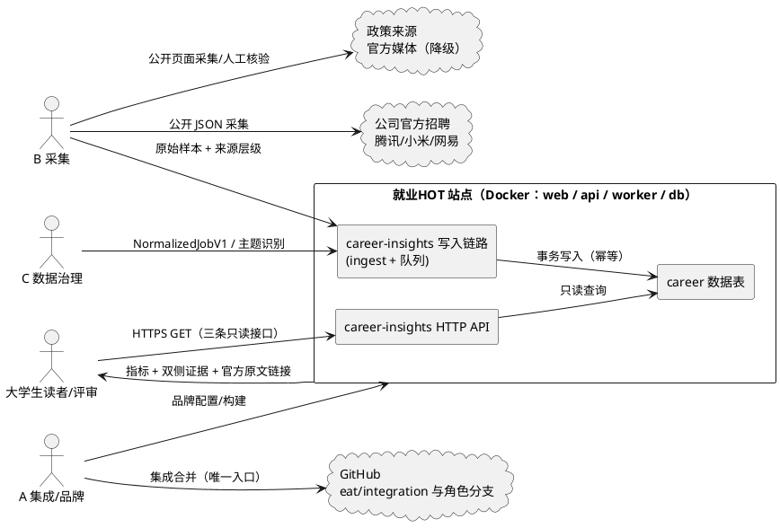
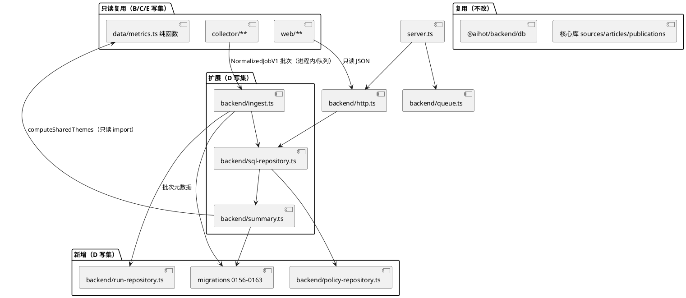
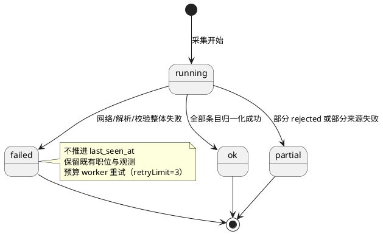
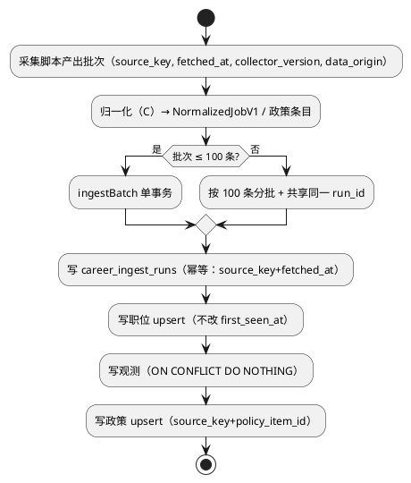
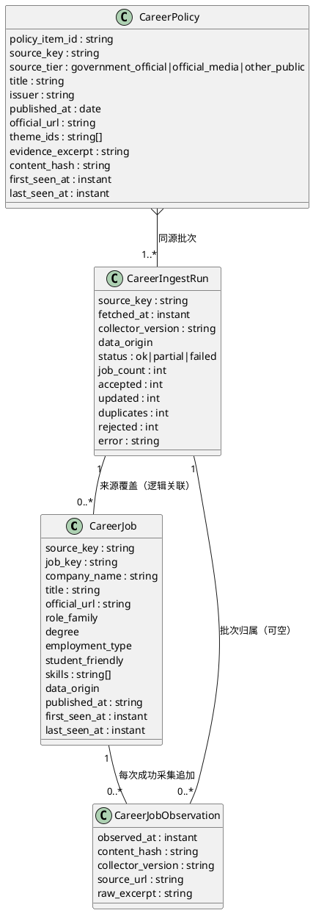
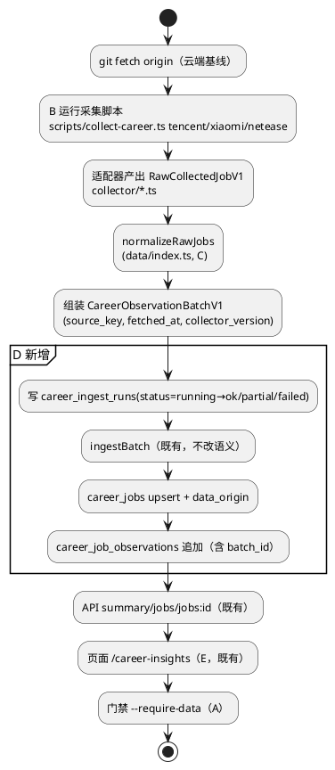
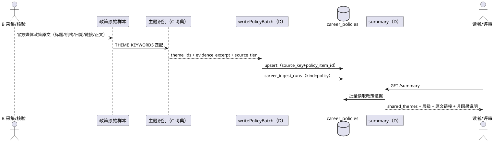

# 就业HOT：技术设计（增量，2026-11-18）

> 文档状态：待评审（Draft，供队长与 A/B/C/E 确认）
> 上游需求：`docs/specs/2026-11-17-career-hot-increment-spec.md`（已确认）
> 权威基线：`origin/feat/integration` @ `21d07eb`（2026-11-17，`git log -3 origin/feat/integration` 实测）
> 本地事实：`HEAD` @ `e2f777c`，落后云端 4 个提交；主工作区存在 B 采集线 6 个未提交文件（`collector/{index,sources,tencent,xiaomi,netease}.ts`、`scripts/collect-career.ts`）
> 角色与写集：D（后端与 API），`modules/career-insights/{server.ts,backend/**,migrations/**}`
> 文档边界：只定义“怎么做、边界在哪、怎么验收”，不含业务实现代码、不新建迁移文件、不改业务代码、不做 Git 提交
> 编号约定：本文统一使用需求编号 D01-xx / D02-xx / OBS-xx / BRAND-xx / GIT-xx，与上游规格一一对应

---

## 0. 已核对的基线事实（影响设计，不可推翻）

| # | 事实 | 证据 | 设计含义 |
|---|---|---|---|
| F1 | 云端 `origin/feat/integration` = `21d07eb`；本地 `HEAD` = `e2f777c`，落后 4 个提交（`21d07eb`、`7842e7c`、`4c81b21`、`c666b46`） | `git log --oneline HEAD..origin/feat/integration` | 任何验收结论必须在同步云端后的独立 worktree 内产生 |
| F2 | 云端已加严 `--require-data`（`c666b46`），本地 `scripts/check-career-integration.ts` 仍是旧版（125 行），云端为加严版（含 job 详情与观测证据校验） | `git diff --stat HEAD origin/feat/integration` | 设计与验收以云端脚本为准，不得按本地旧版结论判断 |
| F3 | career 模块只有 `career_jobs`(0152)、`career_job_observations`(0153) 及两个索引迁移(0154/0155)，无任何政策表 | `modules/career-insights/migrations/` | 政策存储必须新增，或改为复用核心 `publications` |
| F4 | 核心库已有 `sources`(0001_core.sql:10)、`articles`(0001_core.sql:60)、`publications`(0001_core.sql:211) | `database/migrations/0001_core.sql` | 复用 `publications` 需先有 `sources`+`articles`，且走编辑发布流水线 |
| F5 | `buildSummary` 中 `policy_job_shared_themes` 指标写死 `insufficient_data`（`backend/summary.ts:252-261`），`shared_themes` 写死 `[]`（`backend/summary.ts:286`），政策 warning 写死（`backend/summary.ts:273`） | 源码 | D-02 的唯一硬编码点集中在这里，替换面收敛 |
| F6 | `summary`/`jobs`/`jobDetail` 的 `data_origin` 均写死 `"live"`（`backend/summary.ts:277`、`backend/sql-repository.ts:159,189`）；`contract_version` 写死 `"0.1"`（同处） | 源码 | `verified_import`（D01-09）当前无法表达，是必须补的真实缺口 |
| F7 | `observed_new_jobs` 用 `first_seen_at > previous AND <= latest` 计算（`backend/summary.ts:292-322`），快照取 `DISTINCT observed_at ... LIMIT 2`（`backend/summary.ts:139-143`） | 源码 | 跨来源时点会被混成一个全局时间轴，需要按采集批次界定观察窗（见 2.7） |
| F8 | 观测幂等键 `(job_id, observed_at, content_hash)`（0153:10），写入用 `ON CONFLICT DO NOTHING`（`ingest.ts:106-112`）；职位唯一键 `(source_key, job_key)`（0152:29） | 源码+迁移 | 幂等机制已具备，D-01 不得重写 |
| F9 | `ingestBatch` 单批上限 100 条（`ingest.ts:8`），整批单事务（`ingest.ts:140-147`） | 源码 | 3 家 70 条现状安全；扩到 100+ 需分批，扩源时是硬约束 |
| F10 | 迁移安全规则：每个在线迁移**只能一条语句**；索引必须 `CREATE INDEX CONCURRENTLY IF NOT EXISTS`；不允许 `NOT NULL` 无默认值的新增列 | `scripts/migration-safety.ts:66-113` | 新增表 + 索引 + 加列必须拆成多个迁移文件 |
| F11 | 迁移编号：核心库最新 `0151_publications_suppress_original.sql`；career 为 `0152`–`0155` | `database/migrations/`、`modules/career-insights/migrations/` | 新迁移从 `0156` 起，且需与同期其他角色避让（见风险 R7） |
| F12 | 前端已实现 `SharedThemeList`（`web/components/SharedThemeList.tsx`），具备两侧证据渲染与反因果免责声明（第 5 行常量），空列表时整块不渲染 | 源码 | D-02 只需让 `summary.shared_themes` 返回真实数据，E 侧主结构不必重做 |
| F13 | `computeSharedThemes` / `computePolicyJobSharedThemesMetric` 已在 C 的 `data/metrics.ts:332-406` 实现且**未被 `summary.ts` 使用** | 源码 | 存在两套口径风险；D 应只 import C 的纯函数，不复制语义 |
| F14 | `site/site.ts` 中的 AIHOT 残留：`footerNote`(:73)、`poweredBy`(:81)；`MyHOT` 共 4 处（:23、:30、:84、:89）；`site/changelog.json:10` 有 AIHOT 文案 | 源码 | 去品牌是可控的有限改动，见 2.4 |
| F15 | `site/brand/**`（含 `Logo.tsx`、`logo.svg`、`icon*.png`、`favicon.ico`、`nameplates/*.svg`）中 grep **未发现** `AIHOT`/`aihot` 字样 | `grep -rn "AIHOT\|aihot" site/brand` 无输出 | 图形是否属上游 Logo 需人工目视确认，代码层面无文字残留 |
| F16 | ROADMAP §6 的 A 独占写集为：`package.json`、`module.ts`、`contracts/`、`site/modules/`、`site/package.json`、Dockerfile、协作契约文档；**未包含 `site/site.ts`、`site/changelog.json`、`site/brand/**`** | 云端 `ROADMAP.md:264` | 上游规格称 `site/site.ts` 属 A 写集，与 ROADMAP 原文不符；归属必须先由队长裁定（见 3.2） |
| F17 | `scripts/**` 未列入任何角色独占写集；`scripts/check-career-integration.ts` 由 A 在维护 | 云端 `ROADMAP.md:260-268` | 新增采集/导入脚本、扩门禁脚本都需要 A 同意或由 A 执行 |

---

# 一、需求与存量功能关系分析

## 1.1 需求功能与存量功能对比

### 1.1.1 已实现功能（直接复用，不得重写）

| 需求功能 | 存量功能 | 代码位置 | 匹配度 |
|---|---|---|---|
| D01-01 职位与观测入库 | 幂等 `ingestBatch`（校验→事务→upsert→观测） | `modules/career-insights/backend/ingest.ts:117-148`、`ingest.ts:37-115` | 100% |
| D01-01/02 职位唯一与观测幂等 | `UNIQUE(source_key, job_key)`、`UNIQUE(job_id, observed_at, content_hash)` | `migrations/0152_career_jobs.sql:29`、`0153_career_job_observations.sql:10` | 100% |
| D01-03 三个真实 GET API | `summary`/`jobs`/`jobs/:id` 路由与参数校验 | `backend/http.ts:105-121`、`http.ts:62-84` | 100% |
| D01-03 列表筛选与分页 | `jobFilterCondition` + `COUNT` 分页 | `backend/sql-repository.ts:115-168` | 100% |
| D01-04 字段与证据返回 | `JobListItemV1`/`JobDetailV1`/`ObservationPublicV1` 映射 | `backend/sql-repository.ts:72-113`、`contracts/api.ts:79-132` | 100% |
| D01-05 证据可回溯、不透出全文 | `raw_excerpt` 截断 500 字符、`observations` 最多 20 条、`NOTICE` 说明 | `sql-repository.ts:20-22,104-113,180-193` | 100% |
| D01-06 空库门禁 | `--require-data` 校验样本/职位/详情/合成数据 | 云端 `scripts/check-career-integration.ts` | 75%（缺 `source_count>=3`、`has_multiple_snapshots`，见 1.1.2） |
| D01-08 单快照不冒充趋势 | 无两个时点时返回 `insufficient_data` + `value=null` | `backend/summary.ts:239-250` | 100%（口径尚需按批次修正，见 2.7） |
| D02-05 共享主题计算语义 | `computeSharedThemes` 纯函数（双侧非空才返回） | `data/metrics.ts:332-372` | 75%（已实现但未接入 `summary`） |
| D02-07 非因果约束 | 指标 `disclaimer` 已含“不表示因果关系”；页面常量已含同义说明 | `data/metrics.ts:89`、`web/components/SharedThemeList.tsx:5` | 100% |
| D02-08 未识别技能比例 | `unknown_count`/`unknown_ratio` 字段已在契约与指标实现 | `contracts/api.ts:36-37`、`data/metrics.ts:180-181` | 50%（`summary.ts` 的 SQL 路径未返回，见 1.1.2） |
| OBS-04 UTC 序列化 | `Date#toISOString()` 统一输出 `Z` | `sql-repository.ts:68-70`、`summary.ts:52-54` | 100% |
| 队列幂等写入 | `career-insights.ingest`（`retryLimit:3`、进程内 `ingestBatch`） | `backend/queue.ts:6-16` | 100% |

### 1.1.2 需要扩展的功能

| 需求功能 | 存量功能 | 差异说明 | 扩展方向 |
|---|---|---|---|
| D01-09 导入样本标注（`verified_import`） | `data_origin` 恒为 `"live"`（`summary.ts:277`、`sql-repository.ts:159,189`） | 差异：枚举 `DataOrigin` 支持三值（`contracts/job.ts:13`），但写入链路无来源载体，读侧无判定依据；边界：一旦出现人工核验样本，全部数据会被误标为自动采集 | 新增批次记录表承载 `data_origin`；`career_jobs` 增列 `data_origin`（常量默认 `'live'`）；`summary` 改为按当前样本集聚合 `data_origin`（混合时取保守值并在 `warnings` 说明） |
| D02-09 来源覆盖变化 | 无任何采集批次记录；`source_failed`/`stale_data` warning 类型已定义（`contracts/api.ts:20`）但无人写入 | 差异：需要“本次成功/失败、条数、上次成功时间”，当前只能从 `career_job_observations` 间接猜；边界：单来源失败不得让读者推断岗位下架 | 批次表 + `summary` 输出 `source_coverage`（契约可选字段，见 2.2.2）；失败批次保留 `status='failed'` 且不推进 `last_seen_at` |
| D02-05/06/11 政策证据 | `shared_themes=[]`、`policy_job_shared_themes` 恒 `insufficient_data`、warning 写死 | 差异：需要真实政策存储、真实双侧证据、真实空态语义；边界：空政策不得返回 `[]` 冒充“无共同方向”，也不得返回 0 | 新增政策表与政策读路径；`summary` 改为 DB 读取 + C 纯函数计算 + 三档 `insufficient_data`（见 2.6.4） |
| D02-08 未识别技能比例 | `summary.ts` 的 SQL 技能聚合未返回 `unknown_count`/`unknown_ratio`（`summary.ts:194-224` 只给 `numerator`/`denominator`） | 差异：契约有字段、C 纯函数有实现、D 的 SQL 路径没带；边界：`unknown` 不得补成已知技能 | 技能指标改用 C 纯函数结果，或在现有 SQL 分支补 `COUNT(*) FILTER (WHERE skills = '[]')` |
| OBS-02/OBS-03 观察窗差集 | `DISTINCT observed_at LIMIT 2` 的全局时间轴 + `first_seen_at` 区间 | 差异：多来源在不同时点采集时，全局第二时刻可能只覆盖一个来源，差集被低估；边界：差集应是“后快照职位集合 − 前快照职位集合” | 以采集批次为单位计算前/后快照（见 2.7.2）；`value=0` 与 `insufficient_data` 严格分离 |
| D01-06 门禁加严 | 云端门禁已校验 `sample_size>0`、`company_count>0`、`items` 非空、详情有观测 | 差异：未校验 `source_count>=3`、`has_multiple_snapshots`、政策侧就绪度 | 由 A 扩门禁（脚本属 A），D 提供检查项清单与期望输出（见 2.9.3） |

### 1.1.3 需要新增的功能或接口

**A. 政策领域（D-02，本次核心新增）**

1. 政策持久化：`career_policies` 表 + 唯一键 `(source_key, policy_item_id)`。
   - 输入：政策原始样本（标题、机构、发布日期、原文链接、来源层级、主题、原文摘录）。
   - 输出：可查询的政策证据集合，字段与 `PolicyEvidenceRefV1`（`contracts/job.ts:83-92`）一一对应。
   - 依赖：B 提供的 2 个可访问官方媒体来源；C 的主题词典 `THEME_KEYWORDS`/`THEME_LABELS`（`data/dictionaries.ts:131-150`）。

2. 政策读取与写入方法：`CareerRepository` 增 `listPolicies`（内部）与 `writePolicyBatch`（内部），HTTP 面不新增路由。
   - 输入：政策批次（`source_key`、`fetched_at`、`source_tier`、条目数组）。
   - 输出：`{accepted, updated, duplicates, rejected, errors}`，与 `IngestResultV1` 同形。

3. `summary.shared_themes` 真实返回 + `policy_job_shared_themes` 真实状态。
   - 依赖：C 的 `computeSharedThemes`（只 import，不改）。

**B. 观测治理（OBS，本次核心新增）**

4. 采集批次记录：`career_ingest_runs` 表。
   - 输入：每次采集运行的来源、`fetched_at`、`collector_version`、`data_origin`、四种计数、状态与失败原因。
   - 输出：可用于“两个时点”“来源覆盖变化”“导入标注”的权威批次事实。
   - 依赖：`scripts/collect-career.ts` 需把批次元数据传入（脚本属 B/未分配，见 3.6）。

5. 观测与批次的关联：`career_job_observations.batch_id` 可空新增列。

**C. 品牌与站点（BRAND，执行面在 A/队长裁定）**

6. 站名与定位切换为“就业HOT / AI + 就业趋势观察”，并完全移除读者可见的 AIHOT 名称与链接。
   - 输入：`site/site.ts` 的 `SITE.*`、`site/changelog.json`。
   - 输出：导航、标题、分享图、RSS、`llms.txt`、结构化数据、抓取 UA、报头全部使用新名称。
   - 依赖：**归属裁定**（见 3.2）。

**D. 门禁与验收（GIT/验收）**

7. 空库反向验收与真实数据正向验收脚本化清单（命令级，见 2.9）。

---

## 1.2 存量功能详细分析

### 1.2.1 `buildSummary`（`backend/summary.ts:115-290`）

- **接口契约**：入参 `Db`；出参 `SummaryResponseV1`（`contracts/api.ts:52-66`）。副作用：只读。异常：聚合无行时抛 `Summary aggregates returned no row`（:148）；连接类错误由 `SqlCareerRepository.run` 转 `503`（`sql-repository.ts:201-209`）。
- **业务规则**：五项指标固定顺序（职族→技能→学生友好→观测新增→政策共享主题）；职族只对有计数的维度产出 `ok`（:171-192）；技能最多 10 个维度（:19、:134）；证据每条指标最多 5 条（:19）。
- **扩展点**：`metric()` 工厂（:69-83）从 `METRIC_SPECS_V1` 取 label/unit/disclaimer，新增指标种类无需改文案；`policyMetric` 与 `shared_themes` 是唯一硬编码占位，替换面清晰。
- **约束**：
  - 证据查询是“每维度一次 SQL”（:85-113），职族 5 + 技能 10 → 最多 15 次查询；政策接入后若每主题再查一次会触发 N+1 放大，违反 DFX 5.1.2。**政策证据必须一次性批量取回**（见 2.6.5）。
  - `as_of` 取 `MAX(last_seen_at)`（:151、:121-122）；失败采集不得推进该值（`ingest.ts:70-73` 只在成功后 `GREATEST`，已满足）。
  - 快照仅取最近两个 `DISTINCT observed_at`（:139-143），跨来源混轴（F7）。

### 1.2.2 `ingestBatch`（`backend/ingest.ts:117-148`）

- **接口契约**：`(db, CareerObservationBatchV1) → IngestResultV1`；整批单事务；`>100` 条直接 `InvalidParameterError`。
- **业务规则**：逐条 `validateNormalizedJobV1`，非法条目计 `rejected` 并给出 `path: message`（与开发契约 §8.5 对齐）；内容哈希相同只推进 `last_seen_at`，不同则更新当前态但**不改 `first_seen_at`**（:77-104）。
- **扩展点**：`writeJob` 是单条写入的最小单元；批次元数据（`data_origin`、run 记录）应在 `ingestBatch` 外层完成，避免污染职位 upsert 语义。
- **约束**：`ON CONFLICT DO NOTHING` 使同一 `(job_id, observed_at, content_hash)` 重试不新增观测（:112）；`jsonColumn` 必须用 `sql.json()`（:24-28），否则 jsonb 被双重编码。

### 1.2.3 `SqlCareerRepository`（`backend/sql-repository.ts`）

- **接口契约**：实现 `CareerRepository`（`repository.ts:10-15`）四个方法；`jobDetail` 未命中返回 `null`；连接类错误码集合 `ECONNREFUSED/ENOTFOUND/57P03/53300` 转 `DataUnavailableError`。
- **业务规则**：列表排序 `last_seen_at DESC, id ASC`；详情观测最多 20 条、摘录 500 字符；`NOTICE` 固定说明“单次未采集到不代表下架”。
- **扩展点**：`run()` 统一错误映射；新增政策方法可复用该包装。
- **约束**：`data_origin` 与 `contract_version` 为字面量，新增取值需同时改类型与实现——类型在 `contracts/`（A 写集），实现在本文件（D 写集），跨写集协作点（见 3.3）。

### 1.2.4 HTTP 层（`backend/http.ts:105-121`）

- **接口契约**：三条 GET；`summary`/`detail` 拒绝任何查询参数（:25-29）；`jobs` 只接受 6 个筛选键 + `page`/`page_size`（:10、:62-84）；`id` 非 UUID 返回 `400 invalid_parameter`；`Cache-Control: no-store`。
- **约束**：新增字段只能通过响应体扩展，不能新增查询参数（否则 `--require-data` 与前端筛选契约同时受影响）。P1 若要按来源筛政策，需单独评审。

### 1.2.5 门禁脚本（云端 `scripts/check-career-integration.ts`）

- **接口契约**：`checkCareerSite(base, {requireData}) → Array<{path, reason|null}>`；CLI 失败 `exitCode=1`。
- **`--require-data` 现覆盖**：`sample_size>0`、`company_count>0`、`metrics` 非空、`data_origin != synthetic_fixture`、`items` 非空、`total>0`、首条职位 6 个必填字段非空、详情 `observations` 非空且 4 字段非空、非法 UUID 返回 400。
- **缺口（本设计必须补，但执行方是 A）**：无 `source_count>=3`、无 `has_multiple_snapshots`、无政策侧就绪校验、无 `contract_version` 期望值可配置（当前读 `CAREER_CONTRACT_VERSION`，冻结 `1.0` 后需同步）。

### 1.2.6 迁移安全（`scripts/migration-safety.ts:66-113`）

- **硬约束**：一文件一语句；`CREATE TABLE` 允许但不得含 `AS`/`LIKE`/`INHERITS`/`PARTITION`；索引必须 `CREATE INDEX CONCURRENTLY IF NOT EXISTS`；新增列 `NOT NULL` 必须带常量默认值；`ALTER` 一次一个动作。
- **含义**：本设计新增 2 张表 + 2 个加列 + 3 个索引 → **至少 7 个迁移文件**，不能合并。

---

## 1.3 需求到组件的映射总表

| 需求组 | 落点组件 | 新增/复用 | 负责人 |
|---|---|---|---|
| BRAND-01～06 | `site/site.ts`、`site/changelog.json`、`site/brand/**` | 改配置（无新代码） | A（待裁定，见 3.2） |
| BRAND-07 | `SITE.mcpPrefix`、`SITE.interfaceVersion` | 决策项，默认不改 | A |
| D01-01～05、07 | `ingest.ts`、`sql-repository.ts`、`http.ts`、`web/routes/*` | 复用 + 数据接入 | D/B/E |
| D01-06、D01-10 | `scripts/check-career-integration.ts` | 复用 + 加严 | A |
| D01-09、OBS-01～03、D02-09 | `career_ingest_runs`、`career_jobs.data_origin`、`observations.batch_id`、`summary.ts` | 新增 | D |
| D02-01～03、05～07、10～12 | `career_policies`、`summary.ts`、`contracts/` | 新增 + 扩展 | D（契约 A） |
| D02-08 | `summary.ts` 技能指标 | 扩展 | D |
| OBS-04～06 | `toISOString()` 链路、`CareerTime` | 复用 + 复核 | C/D/E |
| GIT-01～10 | worktree + 路线图 + 推送策略 | 流程 | D |

---
# 二、增量设计方案

## 2.1 实现模型

### 2.1.1 上下文视图



图只表达交互关系；协议均为 HTTP(S)，调用频率为“读者按需”与“每阶段一次采集”。

### 2.1.2 服务/组件总体架构



**模块清单（新增 / 扩展 / 不改）**

| 类别 | 组件 | 动作 | 归属 |
|---|---|---|---|
| 复用 | `ingestBatch`（`ingest.ts`） | 在批次外层补 `run` 记录与 `batch_id`，内部 upsert 语义**不改** | D |
| 复用 | 观测/职位唯一键 | 不改 | D |
| 复用 | 三条 GET 路由与参数校验 | 不改 | D |
| 复用 | `career-insights.ingest` 队列 | 不改（批次元数据由调用方组装） | D |
| 复用 | C 的 `computeSharedThemes` 等纯函数 | 只 import，不改文件 | C（只读） |
| 扩展 | `buildSummary` | 替换政策占位、补技能 `unknown_*`、改快照口径 | D |
| 扩展 | `SqlCareerRepository` | 增政策/批次读方法、`data_origin` 按真实值返回 | D |
| 新增 | `career_ingest_runs` 表与读方法 | 新表 + 新方法 | D |
| 新增 | `career_policies` 表与写/读方法 | 新表 + 新方法 | D |
| 新增 | 迁移 `0156`–`0163`（7 个文件） | 见 2.3.3 | D（需 A 评审） |
| 不改 | `collector/**`、`data/**`、`contracts/**`、`web/**`、`module.ts`、`site/modules/**`、`package.json` | 越界即回退 | B/C/E/A |
| 不改 | 核心 `sources/articles/publications` | 本阶段零写入、零读取（见 2.6.2） | 核心 |

### 2.1.3 实现设计（批次状态与写入流程）

**批次状态机（`career_ingest_runs.status`）**



- 触发条件与处理策略：
  - `ok`：`fetched>0` 且 `rejected=0`；推进该来源 `last_seen_at`，写观测。
  - `partial`：有 `rejected>0` 或该来源本次 0 条；**仍推进已成功条目的 `last_seen_at`**，但 `summary` 输出 `source_failed`/`stale_data` warning。
  - `failed`：不写职位、不写观测、不推进 `last_seen_at`；`error` 记录原因。
- 扩展点：来源适配器与归一化由 B/C 提供；D 只定义批次记录与读取契约，新增来源无需改 D 代码。

**写入流程（D-01 与 D-02 共用骨架）**



**事务设计**：职位批次仍用单事务（现状）；批次记录写入放在事务**之前**并以 `running` 落库，避免整批失败后丢失“失败事实”。政策批次同理。

---

## 2.2 接口设计

### 2.2.1 总体设计

| 接口 | 类型 | 稳定性 | 本阶段动作 |
|---|---|---|---|
| `GET /api/site/career-insights/summary` | 公开只读 | 稳定（0.1） | 扩展响应字段（政策/覆盖），不新增参数 |
| `GET /api/site/career-insights/jobs` | 公开只读 | 稳定（0.1） | 不改 |
| `GET /api/site/career-insights/jobs/:id` | 公开只读 | 稳定（0.1） | 不改 |
| `CareerRepository.summary/listJobs/jobDetail` | 内部 | 稳定 | 不改签名 |
| `CareerRepository.writeBatch` | 内部 | 稳定 | 不改签名 |
| `CareerRepository.writePolicyBatch` | 内部（新增） | 实验 | 新增 |
| `CareerRepository.listPolicyEvidence` | 内部（新增） | 实验 | 新增（`summary` 内部调用） |
| `CareerRepository.listRunCoverage` | 内部（新增） | 实验 | 新增（`summary` 内部调用） |

**接口变更策略**：`0.1` 阶段只允许**新增可选字段**；`shared_themes` 结构与 `SharedThemeV1` 保持不动（前端已消费）。`contract_version` 的升级节点是“真实政策 + 真实职位样本验收通过”（D02-12），不是“代码写完”的节点。

### 2.2.2 接口清单

**1) `GET /api/site/career-insights/summary`（契约增量）**

- 入参：无（任何查询参数返回 `400 invalid_parameter`）。
- 出参：`SummaryResponseV1`（`contracts/api.ts:52-66`）+ **新增可选字段**：

```ts
// 契约增量提案（提交给 A，由 A 落到 contracts/api.ts）
interface SourceCoverageV1 {
  source_key: string;
  last_ok_at: string | null;      // UTC Z，来源最近一次成功批次
  last_fetch_at: string | null;   // UTC Z，最近一次尝试
  job_count: number;              // 该来源当前态职位数
  status: "ok" | "failed" | "stale"; // stale：超过约定间隔未成功
}

interface SummaryResponseV1 {
  // ……既有字段不变……
  source_coverage?: SourceCoverageV1[];   // 可选，按 source_key 升序
  snapshot_count?: number;                // 可选，参与观察窗的批次时点数
}
```

- 业务说明：一次请求给出看板所需的全部数字与证据，避免页面多次拼接口。
- 前置条件：数据库可用；否则 `503 data_unavailable`。
- 后置条件：只读，不修改任何表。
- 异常映射：连接类错误 → `503 data_unavailable`；内部错误 → `500 internal_error`（`http.ts:91-93`）。
- 兼容性：旧客户端忽略新增字段；`shared_themes` 元素结构不变，`SharedThemeList` 无需改动。

**2) `CareerRepository.writePolicyBatch`（新增内部接口）**

```ts
writePolicyBatch(batch: CareerPolicyBatchV1): Promise<IngestResultV1>;
```

- `CareerPolicyBatchV1`（建议新增到契约，命名与 `CareerObservationBatchV1` 对齐）：

```ts
interface CareerPolicyItemV1 {
  policy_item_id: string;   // 来源 ID 或规范化 URL 哈希
  title: string;
  issuer: string;
  published_at: string | null;  // YYYY-MM-DD，date-only
  official_url: string;
  source_tier: "government_official" | "official_media" | "other_public";
  theme_ids: string[];
  evidence_excerpt: string;
  content_hash: string;
}

interface CareerPolicyBatchV1 {
  schema_version: "1.0";
  source_key: string;
  fetched_at: string;          // UTC Z
  collector_version: string;
  data_origin: DataOrigin;     // live | verified_import
  policies: CareerPolicyItemV1[];
}
```

- 业务说明：政策批次入库，幂等；重复导入不新增。
- 前置条件：`source_key` 在来源清单中已登记（含 `source_tier` 与来源名称）。
- 后置条件：`career_policies` 新增或更新（`last_seen_at` 推进，`first_seen_at` 不变）；写一条 `career_ingest_runs`（`kind='policy'`）。
- 异常映射：`theme_ids` 非词典值 → `rejected` + `path: message`（不整批失败）；`published_at` 非 `YYYY-MM-DD` → `rejected`。
- 调用示例（验收用，非业务代码）：

```text
node -e "…" 不推荐；正式入口待 3.6 裁定后由 A 提供 scripts 入口
```

**3) `CareerRepository.listPolicyEvidence` / `listRunCoverage`（新增内部查询）**

- 入参：无（窗口由实现固定为“全部当前政策 + 最近两批成功批次”）。
- 出参：`PolicyEvidenceRefV1[]`（按 `published_at DESC, policy_item_id ASC`，上限 50）与 `SourceCoverageV1[]`。
- 用途：`buildSummary` 内部调用；不对外暴露路由。

---

## 2.3 数据模型

### 2.3.1 设计目标

1. 支持“政策证据 + 岗位证据”在同一主题下对照，且两侧都可点回官方原文。
2. 支持“两个真实观测时点”按**批次**界定，而不是全局时间轴。
3. 支持“来源覆盖变化”与“导入样本标注”，且失败不污染当前态。
4. 与存量数据兼容：现有 `career_jobs`/`career_job_observations` 行在新增列后保持可读（`data_origin` 默认 `live`，`batch_id` 可空）。
5. 容量假设：3–5 家 × 50 条/次 × 每日 2 次，一年约 10 万观测行；政策 2–3 源 × 10–30 条，量级极小。

### 2.3.2 模型实现



**表 1：`career_ingest_runs`（新增）**

| 字段 | 类型 | 约束 | 说明 |
|---|---|---|---|
| `id` | uuid | PK, `gen_random_uuid()` | 批次标识 |
| `kind` | text | NOT NULL, CHECK in `('jobs','policy')` | 职位批次 / 政策批次 |
| `source_key` | text | NOT NULL | 与采集器定义一致 |
| `fetched_at` | timestamptz | NOT NULL | 采集时刻，UTC |
| `collector_version` | text | NOT NULL | 可追溯 |
| `data_origin` | text | NOT NULL, CHECK in `('live','verified_import','synthetic_fixture')` | 导入必须标 `verified_import` |
| `status` | text | NOT NULL, CHECK in `('ok','partial','failed')` | 见 2.1.3 状态机 |
| `job_count` / `accepted` / `updated` / `duplicates` / `rejected` | integer | NOT NULL DEFAULT 0 | 计数事实 |
| `error` | text | NULL | 失败原因，不含堆栈与密钥 |
| `created_at` | timestamptz | NOT NULL DEFAULT now() | |

- 幂等键：`UNIQUE (source_key, kind, fetched_at)`。
- 索引：`(source_key, fetched_at DESC)`；`(kind, fetched_at DESC)`。

**表 2：`career_policies`（新增）**

| 字段 | 类型 | 约束 | 说明 |
|---|---|---|---|
| `id` | uuid | PK, `gen_random_uuid()` | 内部主键 |
| `policy_item_id` | text | NOT NULL | 来源 ID 或规范化 URL 哈希 |
| `source_key` | text | NOT NULL | 来源标识 |
| `source_tier` | text | NOT NULL, CHECK in `('government_official','official_media','other_public')` | 降级来源显式标注 |
| `title` | text | NOT NULL | 原文标题 |
| `issuer` | text | NOT NULL | 发布机构，不得编造 |
| `published_at` | date | NULL | 原文日期，date-only |
| `official_url` | text | NOT NULL | 官方域名链接 |
| `theme_ids` | jsonb | NOT NULL DEFAULT `'[]'` | 只能取词典值 |
| `evidence_excerpt` | text | NOT NULL | 支撑主题判断的原文摘录（≤500 字符） |
| `content_hash` | text | NOT NULL | 内容变化判定 |
| `collector_version` | text | NOT NULL | |
| `data_origin` | text | NOT NULL, CHECK in `('live','verified_import','synthetic_fixture')` | |
| `fetched_at` | timestamptz | NOT NULL | 最近一次成功采集 |
| `first_seen_at` / `last_seen_at` | timestamptz | NOT NULL | 首次/最近观测 |
| `created_at` / `updated_at` | timestamptz | NOT NULL DEFAULT now() | |

- 幂等键：`UNIQUE (source_key, policy_item_id)`。
- 索引：
  - `GIN (theme_ids)` —— 主题对照查询。
  - `(published_at DESC NULLS LAST)` —— 政策列表排序。
  - `(source_tier)` —— 来源层级核对（可选，量小可省）。
- 约束说明：`published_at` 缺失时保持 NULL，页面显示“发布日期未知”，**不得**用 `fetched_at` 冒充。

**表 3：`career_jobs` 扩展**

- 新增 `data_origin text NOT NULL DEFAULT 'live'`（常量默认值，符合迁移安全）。
- 存量行自动取 `live`；人工核验导入必须显式写入 `verified_import`。

**表 4：`career_job_observations` 扩展**

- 新增 `batch_id uuid NULL`（不强加外键，避免批次清理阻塞观测保留；逻辑关联）。
- 存量行为 NULL，`summary` 对 NULL 批次按 `observed_at` 回退分组。

### 2.3.3 迁移编号建议（共 7 个文件，一文件一语句）

| 编号 | 文件 | 单条语句 | 阶段 |
|---|---|---|---|
| `0156` | `0156_career_ingest_runs.sql` | `CREATE TABLE career_ingest_runs (...)` | D-01 |
| `0157` | `0157_career_jobs_data_origin.sql` | `ALTER TABLE career_jobs ADD COLUMN data_origin text NOT NULL DEFAULT 'live'` | D-01 |
| `0158` | `0158_career_job_observations_batch.sql` | `ALTER TABLE career_job_observations ADD COLUMN batch_id uuid` | D-01 |
| `0159` | `0159_career_ingest_runs_source_idx.sql` | `CREATE INDEX CONCURRENTLY IF NOT EXISTS career_ingest_runs_source_idx ON career_ingest_runs (source_key, fetched_at DESC)` | D-01 |
| `0160` | `0160_career_policies.sql` | `CREATE TABLE career_policies (...)` | D-02 |
| `0161` | `0161_career_policies_theme_idx.sql` | `CREATE INDEX CONCURRENTLY IF NOT EXISTS career_policies_theme_idx ON career_policies USING gin (theme_ids)` | D-02 |
| `0162` | `0162_career_policies_published_idx.sql` | `CREATE INDEX CONCURRENTLY IF NOT EXISTS career_policies_published_idx ON career_policies (published_at DESC NULLS LAST)` | D-02 |

- `UNIQUE (source_key, policy_item_id)` 写在 `CREATE TABLE` 内，避免额外索引文件。
- 若与 B/C/E 同期编号冲突，一律在**合并前重排自己的编号**，不改已部署迁移（F10、F11）。

---
## 2.4 品牌改造方案

### 2.4.1 归属结论（必须先裁定）

**核对结果**：云端 `ROADMAP.md:264` 定义的 A 独占写集是 `package.json`、`module.ts`、`contracts/`、`site/modules/`、`site/package.json`、Dockerfile、协作契约文档。**`site/site.ts`、`site/changelog.json`、`site/brand/**` 不在 A 写集，也不在 B/C/D/E 任何写集内**，属于未分配共享文件。上游规格 `docs/specs/2026-11-17-…spec.md:38,807` 把它写作 A 的写集，与 ROADMAP 原文不一致，需要在评审时更正记录。

| 路径 | 现状归属 | 是否在 ROADMAP 写集 | 风险 |
|---|---|---|---|
| `site/site.ts` | 未分配（A 实际维护） | 否 | D 直接改即越界，且会与 A 的构建/集成冲突 |
| `site/changelog.json` | 未分配 | 否 | 含 AIHOT 文案（:10），必须改才能满足 BRAND-04 |
| `site/brand/**` | 未分配（A 放置资源） | 否 | 二进制资源冲突风险高 |
| `site/modules/**`、`site/package.json` | A | 是 | 本方案不改 |

**两条执行路径（二选一，由队长裁定）**

- **路径 A（推荐，零越界）**：A 执行全部品牌文件改动；D 只产出“品牌配置差异清单 + 去 AIHOT 验收命令 + 验收结论”，不提交这些文件。
- **路径 B（授权越界）**：队长书面授权 D 单独提交一个**只含 `site/site.ts` 与 `site/changelog.json`** 的 commit，提交说明标注“经队长授权的越界修复”，不触碰 `site/brand/**`（图形由 A 处理），避免二进制冲突。

任何情况下 D 都**不得**在同一个 commit 里混入品牌改动与后端改动（GIT-02）。

### 2.4.2 最小改动面

| # | 位置 | 现值（实测） | 建议值 | 影响面 |
|---|---|---|---|---|
| B1 | `site/site.ts:23` `name` | `"MyHOT"` | `"就业HOT"` | 导航、页面标题、分享图、RSS、MCP 服务名、后台标题、`ABOUT.kicker/description/copyright`、`CARDS.*`、`SEO_TITLES.about` 全部由它派生 |
| B2 | `site/site.ts:28` `subject` | `"AI"` | `"就业"` | `withSubject()/subjectAfter()` 派生出“就业日报”“就业动态”“就业周报”；`REPORTS.motto` 同步 |
| B3 | `site/site.ts:30` `homeTitle` | `"MyHOT — AI 行业动态 · 每日精选与日报"` | `"就业HOT — AI + 就业趋势观察 · 岗位与政策证据"` | 浏览器标题、搜索结果 |
| B4 | `site/site.ts:40` `description` | "从一批 AI 信源里挑出…AI 日报" | 改为“从公司官方招聘与公开政策里整理岗位结构、技能需求与政策共同方向，给出可点回原文的证据” | 搜索摘要、分享卡片、RSS、`llms.txt` |
| B5 | `site/site.ts:44` `tagline` | `"值得关注的 AI 动态"` | `"看得见的岗位需求与政策方向"` | 分享图、海报小字 |
| B6 | `site/site.ts:46` `keywords` | 四项均为 AI 资讯类 | `["就业趋势","AI 岗位","校园招聘","就业政策"]` | 首页结构化数据 |
| B7 | `site/site.ts:73` `footerNote` | `"由 AIHOT 开源框架驱动"` | `null`，或非品牌化“基于开源框架构建”（见 3.9） | 关于页底部 |
| B8 | `site/site.ts:81` `poweredBy` | `{ name: "AIHOT", url: "https://aihot.news" }` | `null` | 侧栏底部、“我的”页（`Sidebar.tsx:134-136`） |
| B9 | `site/site.ts:84` `organization.name` | `"MyHOT"` | `"就业HOT"` | 搜索引擎结构化数据 |
| B10 | `site/site.ts:89` `crawlerName` | `"MyHOTBot/1.0"` | `"JiuYeHOTBot/1.0"` | 采集 User-Agent，不得冒用他人 |
| B11 | `site/site.ts:64` `mcpPrefix` | `"myhot"` | **默认不改**（见 2.4.3） | MCP 工具名、下载文件名、Agent 接入页 CLI 示例 |
| B12 | `site/site.ts:69` `interfaceVersion` | `"4.0.0"` | **不改**（品牌不改变接口语义） | MCP/OpenAPI/`llms.txt` |
| B13 | `site/changelog.json:10` | “用 AIHOT 开源框架搭起了这个站…” | 改为不出现 AIHOT 的更新说明 | 更新日志页 |
| B14 | `site/brand/**` | 未发现文字残留（F15） | 由 A 目视确认图形是否为上游 Logo；若是则替换 | favicon/icon/分享图 |

**不加新机制**：现有 `SITE` 已是单点配置，全站派生都读它（`ABOUT`、`REPORTS`、`CARDS`、`SEO_TITLES` 均引用 `SITE.name/subject`）。本方案不新增配置项，只改值，避免“名称集中可配置”变成“两套配置源”。

### 2.4.3 `mcpPrefix` 与 `interfaceVersion` 的显式决策（BRAND-07）

- 事实：`mcpPrefix` 同时用于 MCP 工具名前缀（`apps/api/src/routes/mcp.ts:44,50,122`）、Agent 接入页 CLI/JSON 示例（`apps/web/app/features/agent/panels.tsx:36`）、分享图与导出文件名（`PosterSheet.tsx:26,53`、`starred.tsx:78`）。
- 决策建议：**保持 `myhot` 不变，P1 再评估**。理由：它是公开接口标识，改名会让“已接入的 Agent 配置”失效，收益仅为观感；`BRAND-06` 只要求“站名可替换”，未要求接口标识随动；`BRAND-07` 要求“显式决策并记录”，本条即为该记录。
- 若队长要求改名：必须同时（1）升 `interfaceVersion` 主版本；（2）在部署说明列出旧→新工具名映射；（3）由 A 单独立项，不与本次评审捆绑。

### 2.4.4 “完全去 AIHOT”的可执行验收

```bash
# 1) 读者可见面与运行时输出（排除构建产物与依赖）
rg -n "AIHOT|aihot\.news" site apps packages modules \
  --glob '!**/build/**' --glob '!**/node_modules/**'
# 期望：仅 LICENSE / NOTICE / README* / docs/ 中的开源归属与上游仓库地址命中

# 2) 站名旧值
rg -n "MyHOT" site apps packages modules --glob '!**/build/**' --glob '!**/node_modules/**'
# 期望：0 命中

# 3) 构建后页面抽查
npm run build -w @aihot/web
curl -s http://localhost:3000/ | rg -o "就业HOT|AIHOT|MyHOT" | sort -u
curl -s http://localhost:3000/about | rg -o "AIHOT|MyHOT|就业HOT" | sort -u
curl -s http://localhost:3000/llms.txt | rg -o "AIHOT|MyHOT|就业HOT" | sort -u
curl -s http://localhost:3000/feed.xml | rg -o "<title>[^<]*" | head -3
```

- `LICENSE`/`NOTICE` 保留上游归属（BRAND-04 明确“开源归属只保留在非读者界面”），**不得**为去品牌删除。
- 通过标准：第 1 条只剩非读者界面命中；第 2 条 0 命中；第 3 条仅出现新站名。

### 2.4.5 评审风险

| 风险 | 说明 | 缓解 |
|---|---|---|
| 名称为工作名 | “就业HOT”未最终确认（3.1） | 全部走 `SITE` 单点，确认后一处替换即可复验 |
| 越界冲突 | D 改 `site/site.ts` 会与 A 的构建/集成冲突 | 路径 A 优先；路径 B 单 commit + 授权记录 |
| 图形版权 | `site/brand/**` 图形可能源自上游 | A 目视确认并替换，不复制 AIHOT Logo |
| 次级文案残留 | 日报/周报/月报/主题页仍用旧行业词 | `subject` 改值即可覆盖主流派生；P1 再统一（BRAND-08） |

---

## 2.5 D-01 实现方案（真实职位数据闭环）

### 2.5.1 端到端数据流与文件落点



| 环节 | 具体位置 | D 的动作 | 边界 |
|---|---|---|---|
| 采集 | `scripts/collect-career.ts`、`collector/{tencent,xiaomi,netease}.ts` | 只运行、不改；B 的未提交改动不纳入 D 提交 | B |
| 归一化 | `data/index.ts` `normalizeRawJobs`、`data/validate.ts` | 只调用 | C |
| 批次记录 | 新增 `backend/run-repository.ts` | 新增 | D |
| 职位写入 | `backend/ingest.ts:117-148` | 在 `writeJob` 中补 `data_origin`、`batch_id` 参数；upsert 语义不变 | D |
| 读侧 | `backend/sql-repository.ts`、`backend/summary.ts` | 按真实值返回 `data_origin`、`source_coverage` | D |
| 页面 | `web/routes/dashboard.tsx`、`web/routes/job.tsx` | 不加筛选参数；仅消费新字段 | E |

### 2.5.2 幂等键与写入语义（明确不改）

| 对象 | 幂等键 | 重复执行的结果 |
|---|---|---|
| 职位当前态 | `(source_key, job_key)` | 内容哈希相同：只 `last_seen_at = GREATEST(...)`；不同：更新字段但 `first_seen_at` 不变 |
| 观测 | `(job_id, observed_at, content_hash)` | `ON CONFLICT DO NOTHING`，精确重试不新增 |
| 采集批次 | `(source_key, kind, fetched_at)` | `ON CONFLICT DO NOTHING`，同一 `fetched_at` 重跑不重复计数 |
| 政策 | `(source_key, policy_item_id)` | 重复导入只推进 `last_seen_at` |

### 2.5.3 时间口径（OBS-04/CD-01）

- 所有读取戳（`fetched_at`、`observed_at`、`first_seen_at`、`last_seen_at`、`as_of`、批次时间）统一 `Date#toISOString()` → 以 `Z` 结尾，保留毫秒。
- 政策 `published_at` 为 `date`（`YYYY-MM-DD`），与职位 `published_at`（text，原文格式）分离；**不得**互相冒充。职位 `published_at` 的规范化属 C 口径（C-01），D 只保证“原样输出或 null”。
- 空值表达：`null` 不输出 `1970-01-01T00:00:00.000Z`。现状 `EMPTY_TIMESTAMP`（`summary.ts:21`、`sql-repository.ts:19`）会把缺失时间伪装成 epoch，属需要修正的点：`sample_size=0` 时 `as_of` 应改为 `null` 需要契约改动（类型从 `string` 变 `string | null`），因此**本阶段保留 epoch 占位，但在 `warnings` 明确“尚无观测”**，把契约清理留到 `1.0` 冻结时统一（见 3.11）。

### 2.5.4 `--require-data` 验收命令与期望

```bash
# 正向：真实数据必须全绿
node scripts/check-career-integration.ts --base http://localhost:3000 --require-data
# 期望：✓ /api/health、✓ /career-insights、✓ summary、✓ jobs、✓ jobs/<id>、✓ 非法 id；"all checks passed"；exit 0

# 反向：空库必须失败
node scripts/check-career-integration.ts --base http://localhost:3000 --require-data
# 期望（空库）：summary 报 sample_size=0、jobs 报 items 空；至少 2 项失败；exit 1

# 数据核对（只读）
psql "$DATABASE_URL" -c "select count(*) as jobs, count(distinct source_key) as sources, count(distinct company_name) as companies from career_jobs;"
psql "$DATABASE_URL" -c "select source_key, count(*) as obs from career_job_observations o join career_jobs j on j.id=o.job_id group by source_key order by source_key;"
psql "$DATABASE_URL" -c "select source_key, fetched_at, status, accepted, updated, duplicates, rejected from career_ingest_runs order by fetched_at desc limit 10;"
```

- 通过标准：`sources >= 3`、`companies >= 3`、`jobs > 0`；每个来源至少 1 条观测；`career_ingest_runs` 至少 3 条 `status='ok'` 的职位批次。
- 现状基线（2026-11-17 实测）：3 家、70 条已入库，网易分页失效（只取首批）；该基线可作为 D-01 的最小事实，但**不构成**两个观测时点。

---

## 2.6 D-02 政策方案（含两方案对比）

### 2.6.1 需求约束提炼

1. 政策必须有：机构、原文日期（date-only）、官方链接、来源层级、主题、原文摘录。
2. 政策与职位只做“共同方向”，不做因果、不做综合分。
3. 空政策必须 `insufficient_data`，不得返回 `[]` 冒充“无共同方向”，不得出现 fixture 政策。
4. 降级来源（官方媒体）必须显式标注，不得称“政府原文”。
5. 真实样本验收后再冻结 `contract_version=1.0`。

### 2.6.2 方案对比

| 维度 | 方案一：新增 `career_policies`（推荐） | 方案二：复用核心 `publications` |
|---|---|---|
| 数据前置 | 无依赖，直接写入 career 自有表 | 需先有 `sources` 行 + `articles` 行（`0001_core.sql:10,60`），再写 `publications`（:211） |
| 写集影响 | 仅 D 写集（`migrations/**`、`backend/**`） | 需写核心表：`sources`/`articles` 由框架采集流程维护，D 直接写属越界；或要求 B 走核心采集器（改造面更大） |
| 领域字段 | `issuer`、`source_tier`、`theme_ids`、`policy_item_id`、`evidence_excerpt` 原生字段 | 无 `issuer`/`source_tier`/`theme_ids`；只能塞 `tags`/`category`，与新闻标签体系混用 |
| 发布门禁 | 无（政策不参与新闻精选） | `visibility`/`eligible`/`selected`/`visible_after`/`selected_ready_at` 门禁（:215-236）会决定政策是否可见，且政策会进入 `/all`、RSS、MCP、日报 |
| 产品语义 | 政策独立成域，看板读取清晰 | 政策混入“AI 精选内容池”，读者会误以为是新闻条目 |
| 编辑流水线 | 不需要 | 需要经过预筛/评分/摘要（`publications.title/summary/reason/score` 必填语义），成本高且可能被模型改写 |
| 降级来源标注 | 表内 CHECK 强制枚举，不会被清洗 | `tags` 可被编辑流程重写，层级可能丢失 |
| 迁移成本 | 3 个文件（1 表 + 2 索引） | 0 个迁移，但需核心流程改造 + 跨角色协调 |
| 回滚成本 | `DROP TABLE IF EXISTS`（迁移安全允许） | 需从 `publications` 删除行，影响 `/all` 与日报 |
| 评审风险 | 需 A 评审新表与契约增量 | 需 A/C/B 共同评审“政策进新闻池”的产品口径，风险更高 |

**推荐：方案一（新增 `career_policies`）**。理由按权重排序：

1. **写集与架构边界**：career 模块当前对核心表零读写（已 grep 确认），方案二会打破这条边界并引入跨角色写冲突。
2. **语义正确性**：政策不是新闻精选，进入 `publications` 会被编辑门禁与评分改写，直接违反“不伪造、可回溯、来源层级不被清洗”的评审红线。
3. **可逆性**：独立表可整表回滚，不污染 `/all`、RSS 与日报。
4. **成本**：3 个迁移 + 1 个 repository，明显小于改造核心发布链路。

**保留的 P1 选项**：若后续要求“政策也进站内搜索/RSS”，由 A 评估建立**只读视图**（`career_policies` → 一个公开投影），而不是反向写入 `publications`。

### 2.6.3 政策入库与来源层级



- `source_tier` 取值与展示：`government_official` → “政府官网”；`official_media` → “官方媒体解读”；`other_public` → “其他公开来源”。页面显示“官方媒体解读”，**禁止**显示“政府原文”。
- 主题识别不命中 → `theme_ids=[]`，该政策不参与共享主题，但仍可在政策证据区展示（P1 政策列表页由 E 决定）。

### 2.6.4 `shared_themes` 计算与 `insufficient_data` 三档语义

**计算路径（避免两套口径）**

1. `summary` 一次性读取：当前政策集（`listPolicyEvidence`，上限 50）+ 当前职位集（必要字段，70–500 条）+ 最近批次。
2. 调用 C 的纯函数 `computeSharedThemes(policies, jobs)`（`data/metrics.ts:332-372`）与 `computePolicyJobSharedThemesMetric(...)`（:375-406），**不复制** `JOB_THEME_SKILLS`/`ROLE_FAMILY_THEMES` 逻辑。
3. 证据裁剪：每主题政策证据 ≤5、职位证据 ≤5（防止响应膨胀），裁剪后再返回。
4. 排序：`job_count DESC, theme_id ASC`（C 已实现，:368-371）。

**三档语义（必须严格区分）**

| 状态 | 条件 | `shared_themes` | `policy_job_shared_themes` | warning |
|---|---|---|---|---|
| 无政策证据 | `career_policies` 为空 | `[]` | `status=insufficient_data`、`value=null` | `insufficient_data`：“尚未接入政策证据，共享主题暂不计算” |
| 有政策但无共享主题 | 政策非空、职位非空、无交集主题 | `[]` | `status=insufficient_data`、`value=null`、`numerator_count=0` | `insufficient_data`：“政策与职位暂未出现同一主题，不代表无共同方向” |
| 有共享主题 | 至少 1 个主题双侧非空 | 非空 | `status=ok`、`value=null`（`theme_list` 不编码数值） | 无 |

- **禁止**：`status=ok` + `value=0` 表示“无共同方向”；用 `[]` 单独表示“暂无数据”而不给 warning；出现 `synthetic-policy-*` 数据。
- `value` 恒为 `null` 是契约既定（`contracts/job.ts:73` `theme_list`），数量由 `numerator_count`（主题数）与各主题 `policy_count/job_count` 承载。

### 2.6.5 非因果与证据结构

- `MetricResultV1.disclaimer` 已由 `METRIC_SPECS_V1` 提供：“共享主题仅表示文本证据重合，不表示政策与招聘需求之间存在因果关系。”（`data/metrics.ts:89`）。
- `SharedThemeV1`（`contracts/api.ts:43-50`）元素结构**保持不动**：
  - `policies: PolicyEvidenceRefV1[]` —— 含 `policy_item_id/title/issuer/published_at/official_url/source_tier/theme_ids/evidence_excerpt`。
  - `jobs: EvidenceLinkV1[]` —— `kind="job"`，`title = 公司 · 标题`，`official_url` 官方链接。
- 页面侧已有反因果常量（`SharedThemeList.tsx:5`），不需要 D 改前端；E 只需在“有政策但无主题”时展示 warning 文案（`summary.warnings` 已驱动）。
- 文案约束：不出现“政策带动招聘”“政策导致需求增长”“预计”“将会”；不计算综合分、不排名为分数。

### 2.6.6 契约变更与冻结

| 变更 | 类型 | 影响 | 执行方 |
|---|---|---|---|
| `SummaryResponseV1.source_coverage?`、`snapshot_count?` | 可选新增 | 前端可忽略；门禁不校验 | A（`contracts/`） |
| `DataOrigin` 枚举 | 不变（已三值） | 只是读侧开始真实返回 | D |
| `CareerPolicyBatchV1`、`CareerPolicyItemV1` | 新增类型 | D 与 B/C 的写入契约 | A + D 提议 |
| `contract_version` `0.1 → 1.0` | 版本升级 | 门禁期望值、OpenAPI、测试同步 | A 主持，D 提供受影响清单 |

**冻结建议**：把“政策表 + `shared_themes` 真实证据 + 两个观测时点”三项验收通过，作为 `1.0` 的唯一触发条件；在此之前保持 `0.1`，避免为赶进度提前冻结。

---
## 2.7 两个观测时点方案

### 2.7.1 目标与红线

- 目标：至少 3 家公司、同一批来源、两次真实采集，形成两个可区分批次；新增/变化只能来自真实快照差集。
- 红线：不伪造 `observed_at`；不回填历史；单快照不得输出趋势或涨跌；未采集到不得推断下架。

### 2.7.2 时点定义（按批次，不按全局时间）

| 概念 | 定义 | 数据来源 |
|---|---|---|
| 观测批次 | 一次成功采集 = 一条 `career_ingest_runs`（`kind='jobs'`，`status='ok'`） | 新表 |
| 快照 | 该批次写入的全部 `job_id` 集合（`career_job_observations.batch_id = run.id`） | 观测表 |
| 前一时点 T1 | 最近两个成功批次中较早的一个 | 批次表 |
| 后一时点 T2 | 最近两个成功批次中较晚的一个 | 批次表 |
| 观察窗新增 | `jobs(T2) \ jobs(T1)` 的 `job_id` 集合，按 `source_key` 分别计算后再并集 | 差集 |
| 时点间隔 | `T2.fetched_at - T1.fetched_at` | 用于验收说明，不参与计算 |

**与现状的差异**：现状用 `DISTINCT observed_at`（`summary.ts:139-143`）+ `first_seen_at` 区间（:303）。当来源 A 在 10:00 采集、来源 B 在 18:00 采集时，全局“第二时刻”只覆盖 B，A 的 10:00 会落到“前一时刻”，差集被高估或低估。改为按批次后，每个来源各自有 T1/T2，语义与规格 OBS-02 一致。

**兼容旧数据**：存量观测 `batch_id` 为 NULL 时，按 `(source_key, observed_at)` 聚合回退，保证已有 70 条数据仍能算出“一个时点”，不会因新列而报错。

### 2.7.3 幂等与重复防护

| 重复类型 | 防护 | 结果 |
|---|---|---|
| 同一批次重跑（相同 `fetched_at`） | `career_ingest_runs UNIQUE(source_key, kind, fetched_at)` + 观测 `ON CONFLICT DO NOTHING` | 不新增批次、不新增观测 |
| 同一天两次采集同源同内容 | 职位 `content_hash` 相同 → 只推进 `last_seen_at`；观测键含 `observed_at` → 新增 1 条新时点观测 | 时点数 +1，职位数不变 |
| 职位内容有更新 | `content_hash` 变化 → 更新当前态，追加观测，`first_seen_at` 不变 | 详情页可见多条观测 |

### 2.7.4 避免“单快照包装成趋势”

1. `has_multiple_snapshots = (可区分批次时点数 >= 2)`；单时点时 `observed_new_jobs` 必须 `insufficient_data` + `value=null`（现状已如此，保留）。
2. 两时点但无新增：`status=ok`、`value=0`、`evidence=[]`，页面文案“本次未发现新增职位”，**不显示**“需求下降/持平”结论。
3. 两时点且新增 > 0：只输出计数与职位证据，**不输出**增长率、环比、趋势线；`disclaimer` 保留“观测新增不等于市场真实新增”。
4. 页面侧（E）在 `has_multiple_snapshots=false` 时隐藏任何变化类图表；`snapshot_count` 可选字段可直接驱动该判断。

### 2.7.5 第二次采集的执行规则

- 间隔：≥30 分钟；建议次日同一时段（3.5 待确认）。间隔 <30 分钟仍如实记录，但验收说明必须标注“观察窗过短”。
- 范围：与第一次**同一组 `source_key`**，不得只采一家凑数。
- 记录：每次采集写入 `career_ingest_runs`；失败批次不参与时点计算，但保留失败事实并在 `source_coverage.status='failed'` 可见。
- 礼貌抓取：同一来源两次运行间隔不得小于该来源约定间隔（B 负责）。

---

## 2.8 Git 与阶段门禁

### 2.8.1 云端基线 worktree（命令序列）

```bash
# 0) 在仓库根目录确认为只读操作，先看清状态
git status --short
git fetch origin --prune

# 1) 断言云端基线（落后即停）
git log --oneline HEAD..origin/feat/integration   # 主工作区：允许有输出（本地落后）
git rev-parse origin/feat/integration             # 记录 21d07eb 的完整 SHA

# 2) 新建独立 worktree（基于云端，不在主工作区开发）
git worktree add "D:/Codex下载/GitHub项目/seevence/AIHOT-d2" \
  -b feat/career-api-d2 origin/feat/integration

# 3) 在新 worktree 内确认基线干净
cd "D:/Codex下载/GitHub项目/seevence/AIHOT-d2"
git log --oneline -1
git status --short          # 期望：空（B 的未提交改动不会被带过来）

# 4) 把云端路线图复制成本地 D 路线图并登记基线
git show origin/feat/integration:ROADMAP.md > /tmp/cloud-roadmap.md
# 依 docs/roadmaps/career-api-roadmap.md 现有格式，更新“基线提交”与阶段表

# 5) 每个阶段完成后的推送（只在本地 review PASS 后）
git push origin feat/career-api-d2        # 只推角色分支
# 禁止：git push origin main / git push --force / 直接向 feat/integration 合并
```

- 若 `feat/career-api-d2` 已存在：`git worktree add ... -b` 会失败，改用新后缀（`-d2b`），**不要**覆盖已有分支。
- 若必须更新已推送分支：`git push --force-with-lease origin feat/career-api-d2`，并在提交说明写明原因（GIT-06）。

### 2.8.2 路线图更新位置

| 文档 | 更新内容 | 时机 |
|---|---|---|
| `docs/roadmaps/career-api-roadmap.md`（本地副本，D 维护） | 基线提交、阶段表状态、验证命令与结果、review 结论、遗留 | 每个阶段开始与结束各一次 |
| `ROADMAP.md`（云端，A 维护） | 不直接改；阶段结论通过 PR 描述交给 A | 阶段结束提交 PR 时 |
| `.codeartsdoer/plans/` | 可在本地写，不提交 | 可选 |

### 2.8.3 本地 review 检查项（每阶段固定跑）

```bash
git status --short                                   # 仅 D 写集
git diff --stat origin/feat/integration...HEAD        # 无 B/C/E/A 文件
git diff origin/feat/integration...HEAD --name-only | rg -v '^(modules/career-insights/(server\.ts|backend/|migrations/))' 
# 期望：无输出（若有输出即为越界，需移除）

npm run typecheck
npx tsc -p modules/tsconfig.json
npm run test:standalone
```

- 逐项判断：写集纯净、迁移可过安全检查、无 `.env`/`.data/`/密钥、无 fixture 冒充真实数据、提交说明含阶段 + 命令 + 数据真实性。

### 2.8.4 推送策略

| 场景 | 动作 |
|---|---|
| 阶段完成且 review PASS | `git push origin feat/career-api-d2` |
| review FAIL | 修复后复验；阶段状态保持“进行中”，不推送 |
| 需要并入集成分支 | 提 PR 到 `feat/integration`，由 A 评审合并；D 不自合 |
| `main` | 任何情况下不推 |
| 分支分叉 | `git rebase origin/feat/integration` 后重跑全部检查；冲突不覆盖云端 |

---

## 2.9 测试与验收计划

### 2.9.1 通用门禁命令（每阶段）

| 命令 | 覆盖 | 预期 |
|---|---|---|
| `npm run typecheck` | 全仓 TS（contracts/backend/api/worker/tests/modules/web） | 0 error |
| `npx tsc -p modules/tsconfig.json` | career 模块独立类型检查 | 0 error |
| `npm run test:standalone` | 不依赖数据库的单元测试 | 全通过（当前 311+） |
| `DATABASE_URL=postgres://127.0.0.1:5432/aihot_test npm test` | 含数据库的集成测试（需本地 PostgreSQL） | 全通过；D 的 ingest/repository 用例必须在内 |
| `npm run build -w @aihot/web && npm run test:web` | 前端构建 + web 测试 | 构建成功、测试通过 |
| `node scripts/check-migrations.ts --base origin/feat/integration` | 迁移不可变性 + 在线安全 | “migration history and online safety checked” |
| `node scripts/smoke.ts --base http://localhost:3000` | 通用站点 smoke | 全通过 |
| `node scripts/check-career-integration.ts --base http://localhost:3000` | 预数据模式（允许 503 渲染） | 全通过 |
| `node scripts/check-career-integration.ts --base http://localhost:3000 --require-data` | 真实数据模式 | 全通过（D-01 起） |

### 2.9.2 新增测试（D 写集）

| 测试点 | 断言要点 | 归属 |
|---|---|---|
| 政策幂等 | 同批次导入两次 → `accepted` 第二次为 0、`duplicates` 全量；`career_policies` 行数不变 | D |
| 政策校验 | `published_at="11月17日"`、`theme_ids=["unknown_theme"]` → `rejected` + `path: message`；不整批失败 | D |
| 来源层级 | `source_tier` 非法 → `rejected`；合法值原样返回 | D |
| 共享主题只返回双侧 | 政策有主题 A、职位无 A → 不返回 A；双侧都有 → 返回且计数正确 | D |
| 空政策语义 | 空政策 → `shared_themes=[]`、`status=insufficient_data`、`value=null`、warning 存在 | D |
| 有政策无交集 | 政策非空、无共享 → `status=insufficient_data`、`numerator_count=0` | D |
| 批次差集 | T1 有 A/B、T2 有 B/C → 新增 = {C}；`value=1`、证据为 C | D |
| 单时点 | 仅 1 个批次 → `insufficient_data`、`value=null` | D |
| 时间格式 | 所有时间字段匹配 `Z$`；政策 `published_at` 匹配 `^\d{4}-\d{2}-\d{2}$` 或 null | D |
| `data_origin` 传播 | 导入批次 → summary `data_origin=verified_import`；自动采集 → `live` | D |

> 测试文件放在 `modules/career-insights/tests/**`。该目录在本地路线图里写作 D 写集，但云端 ROADMAP 未列，属待确认（3.8）。

### 2.9.3 建议交给 A 的门禁加严项

| 检查项 | 期望 |
|---|---|
| `source_count >= 3` | 真实数据必须 3 源以上 |
| `company_count >= 3` | 当前只校验 `>0` |
| `has_multiple_snapshots === true` | 两个时点完成后启用；未完成前允许通过但记录 |
| `shared_themes` 就绪 | 政策阶段完成后要求非空，或 `warnings` 含明确 `insufficient_data` 原因 |
| `contract_version` | 支持按环境变量期望值（`0.1`→`1.0` 切换） |

### 2.9.4 最小验收清单（评审前必须全绿）

1. `git log HEAD..origin/feat/integration` 为空（基于云端）。
2. 3 家公司 + 2 个政策来源，均有来源名、原文链接、时间。
3. `career_ingest_runs` 至少 2 个可区分时点（同源）；职位总数不因重复采集翻倍。
4. `summary`：`sample_size>0`、`company_count>=3`、`source_count>=3`、`has_multiple_snapshots=true`、`shared_themes` 非空或明确 `insufficient_data`。
5. 任一职位详情：≥1 条观测、官方链接可打开、无 `raw_text` 全文字段。
6. 任一政策证据：机构、日期、层级、摘录、原文链接齐全；层级显示“官方媒体解读”。
7. 空库 `--require-data` 必须 exit 1；真实库必须 exit 0。
8. 品牌：`rg "MyHOT"` 0 命中；读者界面无 AIHOT 名称与链接。
9. 全站无因果措辞、无综合分、无趋势线（单时点）。
10. 9 条通用门禁命令全通过。

---

## 2.10 风险与依赖矩阵

| ID | 阻塞项 | 触发条件 | 影响条目 | 降级方案 | 责任 |
|---|---|---|---|---|---|
| R1 | 政策源可达性 | `.gov.cn` 全部不可达（本机代理 schannel 握手失败，实测） | D02-02/03/05 | 用新华网/人民网/中新网；`source_tier=official_media`，页面标“官方媒体解读”；仍不可达则人工核验导入标 `verified_import` | B |
| R2 | 官方媒体是否被评审接受 | 评审认为官方媒体不算“政策源” | D-02 整体 | 保留政策表与机制，样本层降级为“背景材料”并显著标注；不冒充政府原文 | 队长 |
| R3 | B/C 数据未到位 | 归一化/主题词典未复验 | D01-01、D02-05 | D 先用自己的归一化结果联调，但指标口径以 C 为准；C 未复验前不对外宣称指标结论 | C |
| R4 | 政策表迁移评审 | A 不批准新表或要求改编号 | 阶段 2 全阻塞 | 改用方案二（`publications`）但需 A/C/B 联合评审；或推迟 D-02、先交付 D-01 | A |
| R5 | 写集冲突（`site/site.ts`、`tests/**`、`scripts/**`） | 无明确归属即动手 | BRAND、测试、采集入口 | 路径 A：由 A 执行；路径 B：单 commit + 授权记录；脚本由 A 提供入口 | 队长/A |
| R6 | 样本量不足 | 3 家 × 70 条被认为不够 | D01-01、评审 | 扩第 4 家（阿里/字节需 Playwright，B 负责）；不伪造 | B/队长 |
| R7 | 迁移编号冲突 | B/C/E 同期也提交 `0156+` | 阶段 1/2 合并 | 合并前重排自己编号；不改已部署文件 | D |
| R8 | 网易分页失效 | 只取首批 | D01-01 覆盖度 | 接受“首批 + 去重”，在说明中标注覆盖局限；不以分页失效推断岗位减少 | B |
| R9 | 旧库 schema 漂移 | 已应用过早期 `0153`（`id` 为 `nextval`） | D-01 写入 | 接入真实数据前重建库；核验 `is_identity` | A/运维 |
| R10 | 第二次采集失败 | 网络/来源改版 | OBS-01 | `has_multiple_snapshots=false`，隐藏变化类展示；如实标注“仅 1 次观测” | B/D |
| R11 | 契约冻结时点 | 提前冻结 `1.0` | D02-12 | 以“政策 + 两时点”验收全绿为唯一触发条件；未达成保持 `0.1` | A/C/D |
| R12 | 批次表被评审质疑“过度设计” | 认为新增两列一表超出范围 | D01-09、D02-09、OBS-02 | 最小替代：不建表，用 `career_jobs.data_origin` + `observations` 推断来源覆盖（精度下降，需在说明中承认） | A/队长 |
| R13 | 品牌图形版权 | `site/brand/**` 含上游 Logo | BRAND-04 | A 替换为原创图形；文字层面已无残留 | A |
| R14 | 门禁未加严导致误判 | 仍只校验 `company_count>0` | D01-06 | D 在阶段记录中补充 `source_count/company_count` 实测值并作为证据留存 | A/D |

**阻塞判定规则**：任一阻塞未解除时，对应条目只能记为“未开始/受阻”；不得用 fixture、硬编码或编造数据“先过验收”。

---

## 2.11 分阶段实施顺序

> 每阶段严格遵循：开发 → 本地 review（2.8.3 命令全绿）→ 更新路线图 → 提交角色分支 → 进入下一阶段。review 失败不得推进。

| 阶段 | 范围 | 产出 | 验收 | 依赖 | 出口条件 |
|---|---|---|---|---|---|
| **S0 基线** | worktree、路线图副本、云端同步 | `AIHOT-d2` worktree；路线图登记 `21d07eb` | `git log HEAD..origin/feat/integration` 空；`npm run typecheck` 通过 | 无 | 基线一致 |
| **S1 D-01 职位闭环（含批次）** | 迁移 0156–0159；批次记录；`data_origin` 落库与读回；采集 3 家 | 1 表 + 2 列 + 1 索引；`run-repository.ts`；`summary` 返回真实 `data_origin`/`source_coverage` | 3 源 ≥3 公司、`--require-data` 通过、空库反向失败；`career_ingest_runs` ≥3 条 `ok` | S0；B 采集可用 | 真实职位经 DB→API→页面 |
| **S2 D-02 政策证据** | 迁移 0160–0162；`career_policies`；`writePolicyBatch`/`listPolicyEvidence`；`shared_themes` 真实返回；技能 `unknown_*` | 政策表 + 2 索引；`summary` 去掉三处硬编码 | 2 政策源各 ≥1 条；≥1 个双侧主题；空政策 `insufficient_data`；层级显示正确 | S1；B 政策样本；A 批准迁移 | 政策可跳原文、无因果措辞 |
| **S3 两个观测时点** | 第二次采集；批次差集；单快照语义复核 | `summary` 按批次计算新增；`snapshot_count`/`has_multiple_snapshots` 正确 | 两个可区分时点；职位数不翻倍；无新增时 `value=0`；单时点 `insufficient_data` | S1；≥30 分钟间隔 | 差集来自真实快照 |
| **S4 契约冻结与品牌验收** | 契约 `1.0` 提案；品牌改动验收（A 执行） | 契约 patch 清单；品牌验收结论 | 门禁、OpenAPI、测试与 `1.0` 一致；`rg "MyHOT"` 0 命中 | S1–S3 全绿；队长裁定价名 | `1.0` 冻结 |
| **S5 联调与缺陷** | 性能（p95）、503 语义、日志、E 联调缺陷 | 只修缺陷，不加功能 | S1–S4 命令复跑全绿；性能实测记录 | S4 | 可演示 |

**依赖链**：S1 → S2 → S3 → S4 → S5（串行）；S2 的迁移评审可与 S1 并行发起，但**不得**在 S1 review 通过前合入。

---

# 三、设计假设与待确认（不得当作已确认）

| # | 问题 | 设计采用的假设 | 若不成立的影响 | 需要谁拍板 |
|---|---|---|---|---|
| 3.1 | 正式站名是否就是“就业HOT”？是否需要英文名/副标题/域名？ | 以“就业HOT”为工作名，全部走 `SITE` 单点 | 只需改 `site.ts` 一处 + 重建，不影响后端 | 队长 |
| 3.2 | 品牌文件由 A 改还是允许 D 越界？ | 默认路径 A（A 执行）；D 只交清单与验收 | 若走路径 B，需授权记录且单 commit | 队长/A |
| 3.3 | 官方媒体作政策源能否被评审接受？展示层级叫什么？ | 接受，`source_tier=official_media`，展示“官方媒体解读” | 若拒收，D-02 降级为“背景材料”或换源，机制不变 | 队长/评审 |
| 3.4 | 政策存储：新增表 vs 复用 `publications` | **新增 `career_policies`**（2.6.2） | 若强制复用，需 A/C/B 联合评审，工期与风险显著上升 | A/队长 |
| 3.5 | 第二次采集间隔：30 分钟 or 次日同时段 | 设计接受 ≥30 分钟；建议次日同时段 | 间隔过短需在验收说明标注，不改变计算 | B/D |
| 3.6 | 政策入库的正式入口放哪 | 暂定 `backend/` 内部方法 + 由 A 提供 `scripts/` 入口 | 无入口则只能临时命令导入，不可复现 | A |
| 3.7 | 当前 3 家 70 条样本是否够 | 视为 D-01 最小事实，不作为评审充分条件 | 不够则扩第 4 家（Playwright） | 队长/B |
| 3.8 | `tests/**` 与 `scripts/**` 是否属 D 写集 | 假设 `tests/**` 可用（本地路线图已列），`scripts/**` 不用 | 若否，D 的测试需另择位置或由 A 转交 | 队长/A |
| 3.9 | `footerNote`/`poweredBy` 全移除还是保留非品牌化一行？ | 假设全移除（`poweredBy: null`，`footerNote: null`） | 保留则需确认文案不含 AIHOT 与上游链接 | 队长 |
| 3.10 | MCP 前缀是否随品牌改 | **保持 `myhot`**，P1 再评估（2.4.3） | 改名需升 `interfaceVersion` 并单独评审 | 队长/A |
| 3.11 | 缺失时间用 `1970-01-01…` 占位是否可接受 | 本阶段保留，`1.0` 时统一改为 `null` | 评审若要求立即改，需契约类型变更（`string → string \| null`） | A/D |
| 3.12 | 未识别技能比例、来源覆盖变化是否页面可视化 | 本阶段仅 API + warning（P0），可视化归 P1 | 若评审要求可视化，E 需加组件，工期后移 | E/队长 |
| 3.13 | 政策是否也做两个观测时点 | 政策按批次记录但不参与“趋势”；只展示发布日期与原文 | 若要求政策趋势，需新增政策观测语义，超出 P0 | 队长 |
| 3.14 | 是否接受新增 `career_ingest_runs` 与两个列 | 假设可接受（支撑 3 项 P0 需求） | 若否，走 R12 降级，精度下降需书面承认 | A/队长 |
| 3.15 | 迁移编号 0156–0162 是否与同期角色冲突 | 假设当前无冲突，合并前重排 | 冲突则重排，不改已部署文件 | D/B/C/E |

---

# 附录 A：证据索引（评审可逐条核对）

| 结论 | 位置 |
|---|---|
| 云端基线 `21d07eb`、本地落后 4 提交 | `git log --oneline HEAD..origin/feat/integration` |
| 云端门禁已加严（详情 + 观测 + 合成数据） | `git show origin/feat/integration:scripts/check-career-integration.ts` |
| 政策占位三处 | `modules/career-insights/backend/summary.ts:252-261,273,286` |
| `data_origin` 写死 `live` | `backend/summary.ts:277`、`backend/sql-repository.ts:159,189` |
| 观测新增按 `first_seen_at` 区间 | `backend/summary.ts:292-322` |
| 快照取全局 `DISTINCT observed_at` | `backend/summary.ts:139-143` |
| 幂等键 | `migrations/0152_career_jobs.sql:29`、`0153_career_job_observations.sql:10` |
| 观测写入 `ON CONFLICT DO NOTHING` | `backend/ingest.ts:106-112` |
| 单批上限 100 | `backend/ingest.ts:8` |
| C 的 `computeSharedThemes` 未被 summary 使用 | `data/metrics.ts:332-372` vs `summary.ts:286` |
| 前端已具备双侧证据与反因果说明 | `web/components/SharedThemeList.tsx:5,29-79` |
| 核心 `publications` 依赖 `articles`/`sources` 与发布门禁 | `database/migrations/0001_core.sql:10,60,211-244` |
| 迁移一文件一语句、索引须 CONCURRENTLY | `scripts/migration-safety.ts:66-113` |
| 现有迁移编号 | `database/migrations/` 最大 `0151`；career `0152`–`0155` |
| 品牌残留 | `site/site.ts:23,30,73,81,84,89`；`site/changelog.json:10` |
| `site/brand/**` 无 AIHOT 文字 | `grep -rn "AIHOT\|aihot" site/brand` 无输出 |
| A 写集原文（不含 `site/site.ts`） | 云端 `ROADMAP.md:264` |
| 写集总表 | 云端 `ROADMAP.md:260-268` |
| 待确认事项（站名/政策源/契约） | 云端 `ROADMAP.md:325-333` |
| 上游需求编号 | `docs/specs/2026-11-17-career-hot-increment-spec.md:150-187,226-670` |

# 附录 B：本设计明确不做

1. 不写业务实现代码、不新建/修改迁移文件、不改 `contracts/` 与 `site/**`、不做 Git 提交（本次仅产出设计文档）。
2. 不重写已合入的 SQL repository、幂等 ingest、队列与三条 GET API（D01-10）。
3. 不把职位写入核心 `publications`/`articles`，不参与新闻精选与热点算法。
4. 不新增 HTTP 查询参数、不新增公开政策路由（P1 再议）。
5. 不计算综合分、增长率、环比、长期趋势；不输出因果结论。
6. 不使用 AIHOT 名称与 Logo；不编造职位、政策、观测时点、采集日志。
7. 不做政策日报/周报、CSV 导出、多行业、账号体系（P1/不做项）。